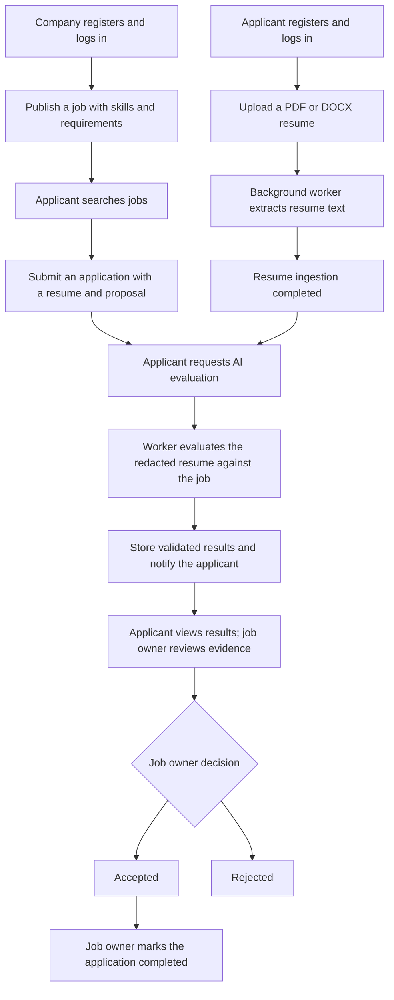
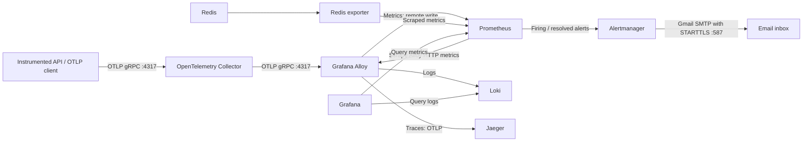

# Fitwork Backend

## Table of Contents

- [Overview](#overview)
- [Core Features](#core-features)
- [Technical Highlights](#technical-highlights)
- [Performance Optimization](#performance-optimization)
- [Tech Stack](#tech-stack)
- [User Flow](#user-flow)
- [Monitoring and Gmail Alerts](#monitoring-and-gmail-alerts)
- [Getting Started](#getting-started)
- [Project Structure](#project-structure)
- [Development Commands](#development-commands)
- [Load Testing with k6](#load-testing-with-k6)

## Overview

Fitwork is a recruitment and project hiring API that connects applicants with companies. Companies publish jobs with requirements, skills, budgets, and deadlines. Applicants upload resumes, submit proposals, and track their applications. AI evaluation compares resume content with a job and provides scores and supporting evidence for human review.

This repository contains the NestJS backend, including REST endpoints, background workers, and Socket.IO gateways. Interactive API documentation is available at `/docs`.

Project specification: [architecture, database schema, API contracts, workflows, and operations](docs/README.md).

Frontend integration guide: [Job API — endpoints, requests, responses, and FE usage (Vietnamese)](docs/api/job.md).

## Core Features

| Feature           | Capabilities                                                                                                                                                                                         |
| ----------------- | ---------------------------------------------------------------------------------------------------------------------------------------------------------------------------------------------------- |
| Authentication    | Register applicant or company accounts; log in with JWT access tokens; rotate refresh tokens; revoke the current refresh token on logout.                                                            |
| Job management    | Create and update jobs with categories, skills, work arrangements, locations, budgets in VND or USD, and due dates.                                                                                  |
| Job discovery     | Public job search with pagination and filters for title, categories, skills, and budget range. Budget filters use VND as the base currency.                                                          |
| Resume management | Upload PDF or DOCX resumes through signed storage URLs; update, preview, download, or soft-delete owned resumes. Files are limited to 5 MiB.                                                         |
| Resume ingestion  | Extract and normalize text in background workers; store content hashes and parser versions; report processing status.                                                                                |
| Applications      | Apply with a resume, cover letter, proposed rate, and estimated delivery time; view application history and status.                                                                                  |
| AI evaluation     | Compare an application's resume with the job using Gemini; return a score, breakdown, strengths, gaps, and an explanation. V2 results also include criterion verdicts and validated resume evidence. |
| Hiring decisions  | Job owners accept or reject applicants and mark accepted applications as completed. Accepting a pending applicant also rejects the other pending applicants for that job.                            |
| Real-time updates | Authenticated Socket.IO subscriptions report resume ingestion and evaluation progress, with the current state returned when joining.                                                                 |

## Technical Highlights

- **Hexagonal architecture:** Feature modules separate HTTP controllers, application services, domain entities and contracts, and infrastructure adapters. Abstract classes define injectable service and repository contracts.
- **Explicit error handling:** Domain and application operations use `neverthrow` results. Controllers translate application errors into HTTP responses, with a global exception filter and DTO validation.
- **Asynchronous processing:** BullMQ queues handle resume ingestion and AI evaluation with three attempts, exponential backoff, and stable job IDs. Workers persist processing and failure states.
- **Evidence validation:** V2 evaluations use one criterion per structured job skill, with equal weights totaling 100. Each result is `MATCHED`, `PARTIAL`, or `MISSING`; cited snippets and character offsets must match the exact redacted resume snapshot. If Gemini supplies wrong offsets but the quote occurs exactly once, the backend resolves its positions before validation. Missing quotes and ambiguous positions are rejected with specific error codes. The backend computes the score from validated contributions.
- **Versioned evaluation inputs:** Stored job snapshots, resume content hashes, redacted text hashes, and parser, redaction, model, and prompt versions tie results to the inputs used. Matching input and model versions reuse existing evaluations.
- **Privacy reduction:** A versioned text preprocessing step redacts detected emails, phone numbers, URLs, and contact header names and addresses before evaluation. Redaction is best effort; names outside the contact header may remain.
- **Structured AI output:** Gemini responses are constrained by JSON schemas and validated with AJV. The V2 prompt treats job and resume text as untrusted data and instructs the model to ignore embedded instructions.
- **Human review:** Company result endpoints verify job ownership and expose evaluation metadata with `decisionSupportOnly: true`. Hiring status changes require an explicit job owner action.
- **Transactional status changes:** Applicant acceptance and rejection of competing pending applications happen in a database transaction, with a job version check to detect conflicting updates.
- **Storage and caching:** S3-compatible storage uses expiring signed URLs and validates uploaded object metadata. Redis caches reference data and completed evaluation responses; job owner authorization runs before reading cached results.

Jobs with structured skills use evaluation V2. Jobs without skills use V1, which provides category scores and narrative evidence. In V2, free-form requirements remain context; they are not automatically converted into scored criteria.

## Performance Optimization

PostgreSQL indexing improvements to the NestJS job-search REST API reduced **p95 search latency by 41.9%** and increased the **reported search request rate by 51.9%** in two local k6 runs with **500 concurrent virtual users**. Both runs completed with **zero HTTP errors** and **100% successful checks**.

### Workload and Database Changes

The applicant workload logs in 500 distinct accounts before search starts, then runs a **10-second warm-up and 60-second measurement**. Each VU reuses its JWT, rotates through 12 search queries against `GET /api/job`, and waits 1–3 seconds between searches. The benchmark database contained **50,060 jobs** and **50,151 job applications**; counts across all 13 application tables were unchanged by the migration.

The [Prisma migration](prisma/migrations/20261010101808_add_job_search_indexes/migration.sql) enables `pg_trgm` and adds three indexes:

- **Composite B-tree:** `job(status, created_at DESC, due_at DESC)`.
- **GIN trigram:** `job(title gin_trgm_ops)`.
- **B-tree:** `job_applicant(status)`.

The migration was deployed successfully, and all three indexes were verified as valid and ready. The application queries and benchmark configuration were preserved.

### Before Index Optimization

| Metric | Result |
| --- | --- |
| Measured search latency (`job_search_measured`) | **Median 4.38s · p95 5.25s · p99 5.34s** |
| Search latency including warm-up (`job_search_sample`) | Median 4.64s · p95 5.35s · p99 5.62s |
| Search requests | 5,957 |
| Reported search request rate | 70.89 req/s |
| Login requests | 500 |
| Login latency | Median 109.35ms · p95 161.50ms · p99 166.87ms |
| Login setup duration | 8.08s |
| All HTTP request latency | Median 4.49s · p95 5.34s · p99 5.62s |
| Total HTTP requests / reported rate | 6,457 / 76.84 req/s |
| HTTP failures | 0 / 6,457 (0%) |
| Successful checks | 6,457 / 6,457 (100%) |
| Iteration duration | Median 6.26s · p95 8.13s · p99 8.54s |

### After Index Optimization

| Metric | Result |
| --- | --- |
| Measured search latency (`job_search_measured`) | **Median 2.10s · p95 3.05s · p99 3.73s** |
| Search latency including warm-up (`job_search_sample`) | Median 2.10s · p95 3.71s · p99 3.99s |
| Search requests | 8,769 |
| Reported search request rate | 107.68 req/s |
| Login requests | 500 |
| Login latency | Median 110.11ms · p95 162.17ms · p99 169.11ms |
| Login setup duration | 8.14s |
| All HTTP request latency | Median 2.07s · p95 3.70s · p99 3.98s |
| Total HTTP requests / reported rate | 9,269 / 113.82 req/s |
| HTTP failures | 0 / 9,269 (0%) |
| Successful checks | 9,269 / 9,269 (100%) |
| Iteration duration | Median 3.88s · p95 5.99s · p99 6.86s |

### Assessment

- **Faster typical responses:** measured search median fell from 4.38s to 2.10s, a **52.1% reduction**.
- **Lower tail latency:** measured p95 fell from 5.25s to 3.05s (**41.9% lower**), and p99 from 5.34s to 3.73s (**30.1% lower**).
- **More work completed at the same configured concurrency:** the reported search rate rose from 70.89 to 107.68 req/s (**51.9% higher**), with 8,769 searches completed after optimization versus 5,957 before.
- **Successful responses under load:** every check passed in both runs, including HTTP 200 and repository-matching payload validation. Login median remained around 110ms, with no HTTP failures across login and search.

Latency comparisons use `job_search_measured`, which records valid searches started after warm-up. The request rates above are native k6 counter averages over the entire run, including login setup, warm-up, and final drain; they are not measurement-window-only throughput. These two runs demonstrate an observed improvement for this workload. Repeated runs under the same environment are needed to quantify variability; measured p95 remains 3.05s at 500 VUs, leaving room for further optimization.

See [Load Testing with k6](#load-testing-with-k6) for reproduction commands and before/after comparison instructions. Figures above are transcribed from the two terminal summaries reported on October 10, 2026.

## Tech Stack

| Area                          | Technologies                                                                                 |
| ----------------------------- | -------------------------------------------------------------------------------------------- |
| Runtime and language          | Node.js 24, TypeScript 5                                                                     |
| API framework                 | NestJS 11, Express, Swagger / OpenAPI                                                        |
| Database                      | PostgreSQL, Prisma 7.8, PostgreSQL driver adapter; `vector` and `pg_trgm` extensions         |
| Queues and caching            | Redis, BullMQ, ioredis, NestJS Cache Manager, Keyv                                           |
| AI                            | Google Gemini through `@google/genai`, AJV JSON schema validation                            |
| File storage                  | S3-compatible object storage through AWS SDK v3                                              |
| Document parsing              | `pdf-parse` for PDF, Mammoth for DOCX                                                        |
| Real-time communication       | Socket.IO, NestJS WebSockets, NestJS EventEmitter                                            |
| Monitoring                    | OpenTelemetry Collector, Grafana Alloy, Prometheus, Alertmanager, Loki, Jaeger, Grafana      |
| Authentication and validation | JWT, bcrypt, hashed opaque refresh tokens, cookie-parser, class-validator, class-transformer |
| Testing                       | Jest, ts-jest, NestJS testing utilities, Supertest                                           |
| Tooling and delivery          | ESLint, Prettier, Husky, lint-staged, Commitlint, GitHub Actions, multi-stage Docker builds  |

## User Flow



### Applicant

1. Register as `APPLICANT` at `POST /api/auth/register`, then log in at `POST /api/auth/login`. Use the returned access token as a bearer token for protected REST calls.
2. Request a signed upload URL at `POST /api/resume/upload-url`, then upload the file directly to storage with an HTTP `PUT` using its content type.
3. Register the uploaded file at `POST /api/resume` with its `storageKey` and a `name`. The backend verifies the object and queues ingestion. Subscribe on `/resume` to wait for `COMPLETED`.
4. Browse `GET /api/job`, then apply at `POST /api/job/:jobPublicId/apply` with `resumePublicId`, `coverLetter`, `proposedRate`, and `estimatedDay`.
5. After applying and completing resume ingestion, request evaluation at `POST /api/applicant-evaluation` with `jobPublicId` and the application's `resumePublicId`. Save the returned evaluation `publicId`.
6. Subscribe on `/evaluation` for progress, then fetch the latest evaluation result at `GET /api/applicant-evaluation/:jobPublicId`. The applicant is resolved from the JWT; only their application to that job is queried. If the latest evaluation is not completed, the endpoint returns `409`. Track applications at `GET /api/job/applied`.

### Company

1. Register as `COMPANY` and log in.
2. Read available reference data at `GET /api/categories`, `GET /api/skills`, and `GET /api/arrangements`.
3. Publish a job at `POST /api/job`. Update its details or open/closed status at `PATCH /api/job/:jobPublicId`.
4. Review a completed evaluation at `GET /api/applicant-evaluation/jobs/:jobPublicId/:evaluationPublicId`. Access is restricted to the job owner.
5. Set an application status at `PATCH /api/job/applicants/:jobApplicantPublicId/status`. Allowed transitions are `PENDING → ACCEPTED`, `PENDING → REJECTED`, and `ACCEPTED → COMPLETED`.

### Resume Reads

Both endpoints require `Authorization: Bearer <accessToken>` and resolve the owner from the JWT. They return only the current user's active resumes registered through `POST /api/resume`.

| Endpoint | Response |
| --- | --- |
| `GET /api/resume?pageNumber=1&pageSize=20` | Paginated list, newest first (`createdAt DESC`, then internal ID for ties). Defaults: page 1, 20 items; maximum page size: 100. |
| `GET /api/resume/:resumePublicId` | Metadata and current ingestion status for one owned resume. |

List responses use the existing `PageResult` envelope: `items`, `totalPages`, `pageNumber`, `pageSize`, `hasPrevious`, and `hasNext`. Each item and the detail response have this shape:

```json
{
  "publicId": "7867f344-036c-58a1-92f9-296c1385357d",
  "fileName": "Backend CV",
  "fileType": "pdf",
  "fileSize": 204800,
  "createdAt": "2026-10-01T00:00:00.000Z",
  "updatedAt": "2026-10-02T00:00:00.000Z",
  "ingestionPublicId": null,
  "ingestionStatus": null
}
```

`fileType` is `pdf` or `docx`; `fileSize` is in bytes. Ingestion fields describe the current uploaded file, not an earlier file replaced through `PATCH`. Status is `PENDING`, `PROCESSING`, `COMPLETED`, or `FAILED`; both ingestion fields are `null` when there is no content record for the current file. These read endpoints return metadata even when parsing is incomplete or failed. They do not return extracted text, storage keys, or internal ingestion errors.

An empty list or a page beyond the last page returns `200` with `items: []`. Detail returns `404` for a missing, deleted, or another user's resume. Invalid pagination or a malformed detail UUID returns `400`; missing or invalid authentication returns `401`; database failures return `500`.

Use the returned resume `publicId` with `GET /api/resume/:resumePublicId/download-url?disposition=inline` to preview the file, or omit `disposition` to download it.

### Real-Time Subscriptions

Connect to the Socket.IO namespace with `auth: { token: accessToken }`. Room subscriptions verify that the resume or evaluation belongs to the applicant.

| Namespace     | Join event and payload                          | Server updates             |
| ------------- | ----------------------------------------------- | -------------------------- |
| `/resume`     | `resume-join` with `{ resumePublicId }`         | `ingestion-process-notify` |
| `/evaluation` | `evaluation-join` with `{ evaluationPublicId }` | `evaluation-score-notify`  |

Join responses include `joined` and the current state when available. Both pipelines use `PENDING`, `PROCESSING`, `COMPLETED`, and `FAILED` states. Leave a resume subscription with `resume-leave` and `{ resumePublicId }`.

## Monitoring and Gmail Alerts

### Monitoring Flow



- **Collector** accepts OTLP traces, metrics, and logs, applies memory limits and batching, and forwards them to Alloy.
- **Alloy** sends metrics to Prometheus's remote write receiver, logs to Loki, and traces to Jaeger. It copies the OTEL `service.name` resource attribute onto metrics as the Prometheus label `service_name`.
- **Prometheus** also scrapes itself, Redis exporter, Loki, and Alloy's HTTP metrics endpoint on port `4201`. Every 15 seconds, it evaluates the rules in `src/monitoring/prometheus/alert.rule.yml` and forwards alerts to `alertmanager:9093`.
- **Grafana** provisions Prometheus, Loki, and Jaeger data sources automatically, plus the `FitWork - Metrics` and `FitWork - Logs` dashboards in the `FitWork` folder. Jaeger traces can be inspected in Grafana Explore or the separate Jaeger UI.
- **Alertmanager** groups and deduplicates alerts, supports silences, and sends firing and resolved email notifications. It runs when the Compose `alerting` profile is enabled. Loki's ruler also points to Alertmanager, but this repository does not include log alert rules.

**Current API instrumentation:** `src/instrumentation.ts` starts the Node.js OpenTelemetry SDK before NestJS loads. Compose sends automatic instrumentation data to the Collector over OTLP gRPC at port `4317`; local runs leave exporters disabled unless `OTEL_TRACES_EXPORTER`, `OTEL_METRICS_EXPORTER`, or `OTEL_LOGS_EXPORTER` is configured. Structured application logs and the `fitwork_*` metrics cover HTTP requests, queue jobs, Gemini usage, cache accesses, and dependency errors. `BackendTelemetryMissing` will fire if the required runtime metric is absent. The backend rules currently match `service_name="fitwork-nestjs-api"`; update those selectors if you change `OTEL_SERVICE_NAME`.

### Monitoring Interfaces

| Service      | Default local URL        | Configuration                                                                                                     |
| ------------ | ------------------------ | ----------------------------------------------------------------------------------------------------------------- |
| Grafana      | `http://localhost:3001`  | `GRAFANA_PORT`; credentials use `GRAFANA_ADMIN_USER` / `GRAFANA_ADMIN_PASSWORD`, defaulting to `admin` / `admin`. |
| Prometheus   | `http://localhost:9090`  | `PROMETHEUS_PORT`; inspect `/targets`, `/rules`, and `/alerts`.                                                   |
| Alertmanager | `http://localhost:9093`  | `ALERTMANAGER_PORT`; active alerts and silences; requires the `alerting` profile.                                 |
| Alloy        | `http://localhost:4201`  | `ALLOY_PORT`; pipeline status and HTTP metrics.                                                                   |
| Loki         | `http://localhost:3100`  | `LOKI_PORT`; log storage queried through Grafana.                                                                 |
| Jaeger       | `http://localhost:16686` | `JAEGER_PORT`; trace search UI.                                                                                   |
| Collector    | `localhost:4317`         | `OTEL_PORT`; OTLP gRPC ingestion, not an HTTP UI.                                                                 |

Grafana uses port `3001` so it can run alongside the API on port `3000`. Prometheus, Loki, Grafana, Alloy, and Alertmanager have named volumes for local state. Configuration files are mounted from `src/monitoring/`.

### FitWork Dashboards

Start or update the monitoring services with `docker compose up -d prometheus loki grafana`. The one-shot `monitoring-volume-init` service prepares the named-volume ownership for the non-root Prometheus and Loki processes without deleting data.

- [FitWork - Metrics](http://localhost:3001/d/fitwork-metrics): request rate, HTTP errors and latency, event loop utilization, queue backlog and outcomes, Gemini latency and tokens, cache accesses, dependency errors, Redis, and scrape health. Set the **Service** filter if you change `OTEL_SERVICE_NAME`; Redis and scrape-health panels are independent of this filter.
- [FitWork - Logs](http://localhost:3001/d/fitwork-logs): log volume and structured logs. Filter by **Event**, or enter an evaluation/resume publicId, BullMQ job ID, request ID, trace ID, route, or text in **Search**. Expand log entries to inspect their attributes.

The **Error details** panel shows `http.request.failed` events with a readable error summary. Expand an entry to inspect `error_message`, `error_code` (when available), `error_stack`, and the sanitized `error_causes` chain. Search the same request ID or trace ID to find its `http.request.completed` event. Server failures include up to 20 stack frames; client errors are warnings without stacks. Diagnostic redaction covers known credential and PII formats; avoid putting raw user payloads in error messages. Prisma query dumps and arbitrary thrown objects are excluded from diagnostics. Cause propagation is supported by `AppError`; the job-search repository and service preserve their underlying errors.

Dashboard JSON files live in `src/monitoring/grafana/dashboards/`. Grafana polls them every 30 seconds after startup; edit those files to persist changes. Business panels can show **No data** until the corresponding traffic or jobs occur. Empty error series do not prove the absence of errors; check scrape health and API telemetry as well. Logs use the `event_domain="fitwork"` and `event_name` labels set by Alloy.

The dashboards resolve the provisioned data sources by name (`Prometheus` and `Loki`) through hidden datasource variables. Datasource provisioning preserves existing generated UIDs, so these dashboards also work with a Grafana volume created before explicit UIDs were introduced.


To diagnose a queue failure, open [FitWork - Logs](http://localhost:3001/d/fitwork-logs) and paste the evaluation publicId (for example `smoke-evaluation-...`) into **Search**. For resume ingestion, use `resume_public_id`, `resume_content_public_id`, or the BullMQ `job_id` value. **Application logs** follows the **Event** selector; **Error details** always includes `http.request.failed`, `queue.job.failed`, and `app.error`, and applies Search to the full record before formatting it.

Each new processing attempt emits exactly one outcome event: `queue.job.completed` at INFO on success, or `queue.job.failed` on failure. A failure is WARN while `attempt < max_attempts`, and ERROR with `final_attempt=true` when the configured limit has been reached. These fields describe the attempt budget; they do not guarantee BullMQ will retry or that the database status is `FAILED`. Retry configuration, API responses, database transitions, and metrics are unchanged. Historical logs retain their original event names, including older failed attempts recorded as `queue.job.completed`.

Expand an error entry to inspect the sanitized root `error_type`, `error_message`, optional `error_code`, `error_stack`, and bounded `error_causes`. Copy `trace_id` into Grafana Explore with the **Jaeger** datasource, or open `http://localhost:16686/trace/<trace_id>` in Jaeger. Queue spans include job/public IDs, attempt limits and outcome; their exception events and Gemini child spans retain sanitized diagnostics. Public IDs are log/trace attributes and are never metric labels or indexed Loki labels.

After changing instrumentation, rebuild and recreate the API with `docker compose up -d --build --no-deps fitwork-nestjs-api`. Grafana reloads the provisioned dashboard within 30 seconds. No migration or new dependency is required. To verify diagnostics using fake services and a stubbed Gemini 404, run:

```bash
npm run build
node scripts/bullmq-diagnostics-smoke.cjs
```

The smoke fixture calls the processors directly, exports telemetry to the local Collector, and checks the provisioned dashboard through Grafana's Loki datasource and the matching traces in Jaeger. It creates synthetic logs/metrics/traces only: it never enqueues a real job, changes application data, or calls Gemini. It reads local port overrides and Grafana credentials from `.env`; the monitoring stack must be running. The final output includes synthetic public IDs and Grafana/Jaeger links.

### Alert Rules

| Alert                     | Condition                                                                                  | Hold time | Severity |
| ------------------------- | ------------------------------------------------------------------------------------------ | --------- | -------- |
| `TelemetryPipelineDown`   | Prometheus cannot scrape Alloy.                                                            | 1 minute  | Critical |
| `BackendTelemetryMissing` | The backend's `nodejs_eventloop_utilization_ratio` metric is absent.                       | 2 minutes | Critical |
| `RedisExporterDown`       | Prometheus cannot scrape Redis exporter.                                                   | 1 minute  | Critical |
| `RedisDown`               | Redis exporter reports `redis_up == 0`.                                                    | 1 minute  | Critical |
| `HighRequestLatency`      | Average HTTP duration exceeds 2 seconds, with at least 20 requests in the last 5 minutes.  | 1 minute  | Warning  |
| `HTTPErrorRate`           | HTTP 5xx responses exceed 5% of requests, with at least 20 requests in the last 5 minutes. | 2 minutes | Warning  |

Latency alerts remain firing for another 5 minutes after the condition clears. Alertmanager groups by alert name and severity, waits 30 seconds before the first notification, checks group changes every 5 minutes, and repeats ongoing alerts every 4 hours. Rule hold times and evaluation intervals are added to the notification delay.

### Configure Gmail Delivery

1. Enable Google **2-Step Verification**, then create an **App Password** for Alertmanager. Use that password for SMTP authentication. See [Google's App Password instructions](https://support.google.com/mail/answer/185833?hl=en). If your account does not offer App Passwords, check the account or Workspace administrator restrictions described there.
2. Add the sender and recipient to `.env`. Each setting accepts one plain email address; the sender must be the account that generated the App Password. The recipient can be the same Gmail address.

   ```env
   SMTP_GMAIL_USER=your-account@gmail.com
   ALERT_EMAIL_TO=your-account@gmail.com
   ALERTMANAGER_PORT=9093
   GRAFANA_PORT=3001
   ```

3. Store only the App Password, without display spaces, in `.secrets/gmail-app-password`:

   ```bash
   mkdir -p .secrets
   chmod 700 .secrets
   ${EDITOR:-vi} .secrets/gmail-app-password
   chmod 444 .secrets/gmail-app-password
   ```

   The private directory protects the file on the host. Read permission on the file lets the container's unprivileged user read the bind-mounted Compose secret. `.secrets/` is ignored by Git. The password is mounted only into Alertmanager at `/run/secrets/gmail_app_password` and is not inserted into the generated YAML. The startup script renders email addresses, validates the config with `amtool`, and starts Alertmanager.

4. Start monitoring with email delivery enabled:

   ```bash
   docker compose --profile alerting up -d redis redis-exporter otel-collector alloy prometheus loki jaeger grafana alertmanager
   ```

   To include the API and database, run `docker compose --profile alerting up -d --build`. Gmail uses `smtp.gmail.com:587` with required TLS; allow outbound access to that endpoint. See [Google's SMTP settings](https://support.google.com/mail/answer/7104828?hl=en).

### Verify Alerts

Validate the running configuration and inspect delivery logs:

```bash
docker compose --profile alerting config --quiet
docker compose exec prometheus promtool check config /etc/prometheus/prometheus.yml
docker compose --profile alerting exec alertmanager amtool check-config /tmp/alertmanager.yml
docker compose --profile alerting logs --tail=100 alertmanager prometheus
```

After Gmail is configured, submit a manual alert to test email delivery. It expires in 2 minutes and also tests the resolved notification:

```bash
python3 - <<'PY' | curl --fail-with-body -sS \
  -H 'Content-Type: application/json' \
  --data-binary @- http://localhost:9093/api/v2/alerts
from datetime import datetime, timedelta, timezone
import json

expires = datetime.now(timezone.utc) + timedelta(minutes=2)
print(json.dumps([{
    'labels': {'alertname': 'GmailDeliveryTest', 'severity': 'info'},
    'annotations': {
        'summary': 'Fitwork Gmail delivery test',
        'description': 'Manual test alert; expires automatically after 2 minutes.'
    },
    'endsAt': expires.isoformat()
}]))
PY
```

Use your configured `ALERTMANAGER_PORT` if it differs from `9093`. The first email normally follows the 30-second group wait; the resolved email follows a later group interval. This manual test verifies Alertmanager-to-email delivery. Check Prometheus's `/alerts` page separately to confirm rule evaluation. Check Spam and Alertmanager logs if no email arrives; authentication failures usually require checking the sender address and App Password.

After changing `.env` email settings, run `docker compose --profile alerting up -d --force-recreate alertmanager`. After editing the mounted Alertmanager template or replacing the password file, recreate the container so its rendered configuration and secret mount refresh. Configuration details are in the [Alertmanager reference](https://prometheus.io/docs/alerting/latest/configuration/).

## Getting Started

### Prerequisites

- Node.js 24 and npm.
- PostgreSQL with the `vector` extension available, and Redis.
- An S3-compatible bucket and credentials.
- A Gemini API key and model name for applicant evaluation.

### Install and Configure

```bash
npm ci
cp .env.example .env
```

Configure `.env` with your database, Redis, authentication, storage, and AI settings:

| Variables                                                                           | Purpose                                                                                                  |
| ----------------------------------------------------------------------------------- | -------------------------------------------------------------------------------------------------------- |
| `DATABASE_URL`, `DIRECT_URL`                                                        | PostgreSQL connections for the application and Prisma CLI. Set both to valid URLs for local development. |
| `REDIS_URL`, `CACHE_TTL`                                                            | Redis connection URL and cache lifetime in milliseconds.                                                 |
| `JWT_SECRET`                                                                        | Secret used to sign and verify access tokens.                                                            |
| `JWT_ACCESS_EXPIRES_IN_SECONDS`, `JWT_REFRESH_EXPIRES_IN_DAYS`                      | Token lifetimes; defaults are 900 seconds and 30 days.                                                   |
| `S3_API_ENDPOINT`, `S3_BUCKET_NAME`, `S3_ACCESS_KEY_ID`, `S3_SECRET_ACCESS_KEY`     | S3-compatible endpoint, bucket, and credentials.                                                         |
| `LLM_EVALUATION_KEY`, `LLM_EVALUATION_MODEL`                                        | Gemini API key and evaluation model name.                                                                |
| `POSTGRES_USER`, `POSTGRES_DB`, `POSTGRES_PASSWORD`, `REDIS_PASSWORD`, `REDIS_PORT` | Local database and Redis service settings when using Docker Compose.                                     |

The example file repeats Redis settings; consolidate them so each key has one configured value. For the API running on your host, use a Redis URL such as `redis://:your-password@localhost:6379` and a cache TTL such as `300000`.

To start only the local database and Redis from the supplied Compose configuration:

```bash
docker compose up -d database redis
```

Generate the Prisma client and initialize a **new local development database** from the schema:

```bash
npx prisma generate
npx prisma db push
npm run start:dev
```

The generated client lives in `generated/prisma` and is excluded from Git. Run generation after cloning and after schema changes. Populate categories, skills, and work arrangements before creating jobs that reference them.

The API defaults to `http://localhost:3000`, with Swagger at `http://localhost:3000/docs`. Set `PORT` to change the API port. Local HTTP and WebSocket CORS allow `http://localhost:5173` and `http://localhost:3000`.

### Demo Seed

After generating the client and initializing your local database, run:

```bash
npm run seed
# Optional: applies only to newly created accounts
SEED_PASSWORD='YourDemoPassword@123' npm run seed
```

The seed loads `.env` and connects using `DIRECT_URL` when nonempty, otherwise `DATABASE_URL`. It requires only PostgreSQL; it does not contact storage, Redis, or Gemini. It creates 10 company accounts/profiles, 50 applicant accounts/profiles, 10 categories, 30 skills, 3 arrangements, 60 jobs (50 open and 10 closed), 50 resumes with completed parsed content, and 150 pending applications. Each applicant applies to three open jobs with high, partial, and low skill overlap. Names and locations are Vietnamese; job and resume content is English.

Run it again to create only missing records. Existing text, passwords, statuses, relations, and AI results are preserved. Existing jobs retain their skill relations, including skills you removed. Conflicting emails, fixture UUIDs, owners, or compound identities stop the seed with an error; earlier transaction groups may already have committed. Open-job deadlines are 90 days after their first creation and are preserved on reruns. The seed prints created/existing counts and a sample applicant, company, job UUID, and resume UUID.

Demo logins use password `FitworkDemo@123` unless you set `SEED_PASSWORD` before creating them:

- Companies: `company01@seed.fitwork.test` through `company10@seed.fitwork.test`.
- Applicants: `applicant01@seed.fitwork.test` through `applicant50@seed.fitwork.test`.

Log in as the sample applicant at `POST /api/auth/login`:

```json
{
  "email": "applicant01@seed.fitwork.test",
  "password": "FitworkDemo@123"
}
```

Use the returned access token as `Authorization: Bearer <accessToken>`, then call `POST /api/applicant-evaluation`:

```json
{
  "jobPublicId": "a4578085-54c7-5dab-90a2-0a3e45937aed",
  "resumePublicId": "7867f344-036c-58a1-92f9-296c1385357d"
}
```

These stable IDs belong to applicant 01's high-overlap application and a job owned by `company01@seed.fitwork.test`. Browse `GET /api/job` and view applications at `GET /api/job/applied`. The seed creates no `ApplicantEvaluation` or `RefreshToken`; login and evaluation API calls create them. To process AI evaluations, run the API with its BullMQ workers, Redis, and valid `LLM_EVALUATION_KEY` / `LLM_EVALUATION_MODEL` Gemini settings.

**Demo CVs are simulated parsed data, with no downloadable files.** Their storage paths and PDF metadata are placeholders; `fileSize` measures the fixture text bytes. `ResumeContent.extractedText` contains the synthetic CV, with parser version `seed-text-v1`, a SHA-256 content hash, and metadata marking it as simulated. Evaluation uses this database text without downloading a file.

To run the seed integration test, initialize a separate, empty PostgreSQL database with the schema and pass its URL explicitly:

```bash
npx prisma db push --url "$SEED_TEST_DATABASE_URL"
npm run test:seed
```

Set `SEED_TEST_DATABASE_URL` to that disposable database in your shell before these commands. The test checks ownership, credentials, currency conversion, snapshots/hashes, reruns, preservation of edits and AI records, identity conflicts, and evaluation preparation through real repositories with a fake queue. It never calls the LLM or clears existing data, but it leaves deliberately edited test records behind. Without the variable, the suite is skipped.

## Project Structure

```text
src/
  modules/
    auth/                   # Registration, login, and token lifecycle
    users/                  # User entities and persistence
    job/                    # Jobs, reference data, and applications
    resume/                 # Resume management and ingestion
    applicant-evaluation/   # AI evaluation, evidence validation, and results
    realtime/               # Socket.IO gateways and progress events
  monitoring/               # Collector, Alloy, Prometheus, Loki, Grafana, and Alertmanager
  shared/
    application/            # Shared application contracts
    common/                 # Guards, validation, errors, and Swagger helpers
    domain/                 # Shared domain types
    infrastructure/         # Database, cache, queues, parsers, and storage
prisma/
  schema.prisma             # Prisma generator and datasource
  models/                   # Feature models and enums
  seed.ts                   # Demo seed entrypoint
  seed/                     # Fixtures and create-only database logic
scripts/                    # Environment doctor and module scaffolding CLIs
test/                       # E2e tests and configuration
```

Each feature follows the `api/`, `application/`, `domain/`, and `infrastructure/` layout where applicable. Unit tests are colocated as `*.spec.ts`; E2e tests use `*.e2e-spec.ts`.

## Development Commands

| Command                                 | Purpose                                          |
| --------------------------------------- | ------------------------------------------------ |
| `npm run start:dev`                     | Start the API in watch mode.                     |
| `npm run build`                         | Compile the application.                         |
| `npm run seed`                          | Create missing demo data in PostgreSQL.          |
| `npm run test:seed`                     | Verify seed on an empty disposable database.     |
| `npm run lint`                          | Run ESLint with automatic fixes.                 |
| `npm run lint:check`                    | Check ESLint without modifying files.            |
| `npm run format`                        | Format source and test TypeScript files.         |
| `npm test`                              | Run unit tests.                                  |
| `npm run test:cov`                      | Run unit tests with coverage.                    |
| `npm run test:e2e`                      | Run E2e tests.                                   |
| `npm run scaffold -- <kebab-case-name>` | Generate and register a feature module skeleton. |

After Prisma model changes, run `npx prisma format`, `npx prisma validate`, and `npx prisma generate`.

Husky runs lint-staged on commit, a build before push, and Commitlint for Conventional Commit messages.

GitHub Actions runs two required-check candidates on pull requests and pushes to `develop` and `main`:

- **Backend checks**: installs dependencies with Node.js 24, validates and generates Prisma, checks lint without changing files, runs unit tests, and builds the application.
- **PostgreSQL integration tests**: starts a disposable `pgvector/pgvector:pg15` service, applies all migrations to separate empty seed and performance test databases, and runs `test:seed` and `test:perf`. The latter includes the tests under `scripts/perf` and real database search tests; it does not run k6 load benchmarks or call external AI services.

For changes to Docker build inputs, PRs targeting `main` also build the image after both checks pass. Every successful push to `main` builds and publishes `fitwork-be-nestjs-api:sha-<full-commit-sha>` to Docker Hub, including documentation-only pushes, so coalesced pending runs cannot lose a code change. The image also gets `latest` when the run's commit matches the current `main` head at the metadata step; rerunning an older commit only publishes its SHA tag. Configure repository Actions secrets `DOCKERHUB_USERNAME` and `DOCKERHUB_TOKEN` (with write access to that image repository). PR builds do not log in or need these secrets. `docker_ci.yml` is a reusable workflow called by `backend_ci.yml`, so image publication cannot bypass the backend checks.

Jobs have time limits. New commits cancel obsolete PR runs; push runs are serialized per branch, with at most one pending run retained. CI does not deploy to a server.

Branch protection on `main` requires **Backend checks** and **PostgreSQL integration tests**, with the PR branch up to date before merging; administrators retain the default bypass. Apply the same requirements when `develop` is created (that branch does not yet exist on GitHub). Both checks run even for documentation-only changes. Branch protection is configured in GitHub repository settings, not in workflow YAML.

## Load Testing with k6

Run commands from the repository root, with dependencies installed and `k6 >= 1.5` available on `PATH` for applicant runs (`k6 version` checks this; search-only matrix/mixed require `>= 0.57`). Keep the API running in another terminal using your usual development or Docker setup. PostgreSQL/Redis must be available, and `.tmp/job-benchmark/manifest.json` must describe the existing 50,000-job benchmark dataset. See [seed and benchmark setup](scripts/perf/README.md) if setting up a new database.

### Applicant login and search: 300/500 VUs

This profile reads `.env`, selects distinct active seed/perf applicant accounts from the database, and creates only missing accounts. Before any VU searches, k6 `setup()` logs in all selected accounts through `POST /api/auth/login` in batches of at most 10, then verifies their tokens cover the complete search workload. Only after every account is ready do VUs start the 10-second search warm-up and 60-second measurement. Each VU reuses its own token and rotates through 12 job-search queries with 1–3 seconds between searches. You do not need to obtain an access token manually; no login traffic runs during search measurement.

```sh
# Check login, sessions and all search queries with 2 VUs first.
npm run bench:applicant:k6 -- --smoke --label applicant-smoke

# Run 300 VUs, then 500 VUs, sequentially.
npm run bench:applicant:k6 -- --label applicant-before-index

# Run just one load level.
npm run bench:applicant:k6 -- --vus 500 --label applicant-500
```

Each full load level has a 10-second warm-up and 60-second measurement, with a 10-second request timeout/graceful stop. The default 300/500 run takes about 3 minutes plus preflight, login preparation and SQL analysis. Login preparation has a 10-minute timeout and fails before search if any account cannot log in or has insufficient token lifetime. VUs represent concurrent applicant sessions; 500 VUs does not mean 500 requests per second.

The runner shows the native k6 banner, VU/iteration progress and result summary in the terminal. Read **`job_search_measured`** for p50/median, p95 and p99 of valid HTTP 200 searches started after warm-up. Native HTTP statistics include login setup, search, warm-up and errors; `job_search_sample` includes search warm-up/errors. The aggregate report separates login from search and excludes login preparation from search measurement time and throughput. It prints the report path at the end.

Configuration defaults:

| Variable | Applicant profile behavior |
| --- | --- |
| `API_BASE_URL` | Defaults to `http://127.0.0.1:$PORT`, or port `3000` when `PORT` is unset. |
| `PERF_DATABASE_URL` | Defaults to `DATABASE_URL` from `.env`; must be reachable from the terminal running the benchmark. |
| `API_DATABASE_URL` | Defaults to `DATABASE_URL`, then `PERF_DATABASE_URL`; must identify the database actually used by the API. |
| `K6_APPLICANT_PASSWORD` | Uses this value, then `SEED_PASSWORD`, then the demo default `FitworkDemo@123`. |

Export overrides if the running server differs from `.env`. Only accounts under `@seed.fitwork.test`/`@perf.fitwork.test` with a matching password are reused. Existing accounts/passwords and job data are preserved. Add `--no-seed-accounts` to stop when there are too few eligible accounts instead of creating more.

### Run directly with `k6 run`

Prepare the account/config files first, then run the exact command printed by preparation in the same terminal:

```sh
npm run bench:applicant:k6 -- --prepare-only --vus 500 --label direct-500
export K6_APPLICANT_PASSWORD='<the password used for seed applicants>'
# Copy and run the printed K6_CONFIG=... K6_APPLICANT_ACCOUNTS_FILE=... k6 run ... command.
```

Use `FitworkDemo@123` for unchanged default seed accounts. Preparation verifies the database and API and may create missing accounts; it does not run the load workload or SQL EXPLAIN. Add `--smoke` to prepare a 2-VU smoke instead. If preparing both 300/500 levels, run the printed commands sequentially.

The printed command sets the following file inputs and invokes k6 directly:

```sh
K6_CONFIG='<run-directory>/applicant-vu500.config.json' \
K6_APPLICANT_ACCOUNTS_FILE='<run-directory>/applicant-accounts.json' \
k6 run --new-machine-readable-summary scripts/perf/k6/job-search.js
```

The actual printed command also exports metrics and a JSON summary. Use the printed `--new-machine-readable-summary` option when exporting a summary: the legacy summary format includes `setup_data`, which can contain session tokens. Config/account files contain queries, expected payloads and account identities; passwords/tokens are not stored in these files or the new-format summary. Direct k6 runs use the same login-before-search sequence and show the native terminal summary, while aggregate reports, baseline comparison, post-load data checks and SQL EXPLAIN require the npm runner. Prepare again if the dataset changes before running the load.

### Reports and before/after comparison

Each runner invocation creates a separate directory under `.tmp/job-benchmark/k6/<label>-<timestamp>/` containing `report.md`, `report.json`, and per-case config, metrics, summary and sanitized logs. Reports include p50/p95/p99, successful requests/second, request counts, timeout/HTTP/transport/payload errors and authenticated VUs. Failed or interrupted runs retain completed artifacts.

Create a new baseline with the login-before-search workflow; reports from the previous overlapping login/search workflow cannot be compared to it. After adding an index, use the same workload, account pool, dataset and environment:

```sh
npm run bench:applicant:k6 -- --label applicant-after-index \
  --baseline .tmp/job-benchmark/k6/<applicant-before-index-run>/report.json
```

Comparison rejects different workloads or data/counts and records index changes. If smoke fails with login HTTP 401/403, check the seed password, account status and permissions. Login HTTP 500 with Prisma `P1001` in server logs indicates a database connection problem; fix the API connection before running the load.

For the search-only index baseline, use `npm run bench:job:k6 -- --smoke`, then `npm run bench:job:k6 -- --label before-index`. This runner requires explicit `API_BASE_URL`, `ACCESS_TOKEN`, `PERF_DATABASE_URL` and `API_DATABASE_URL`; its `matrix` profile tests individual criteria at 1/10/50 VUs, and `mixed` tests 25/50/100 requests/second. See [detailed k6 benchmark instructions](scripts/perf/README.md#k6-job-search-trướcsau-index) for token lifetime, full workload and comparison options.
