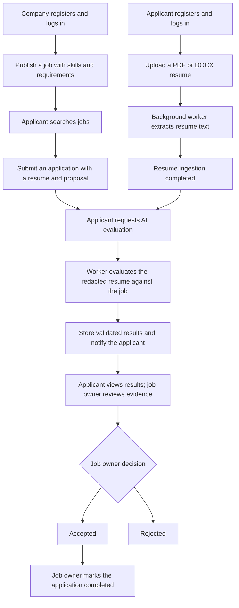

# Fitwork Backend

## Overview

Fitwork is a recruitment and project hiring API that connects applicants with companies. Companies publish jobs with requirements, skills, budgets, and deadlines. Applicants upload resumes, submit proposals, and track their applications. AI evaluation compares resume content with a job and provides scores and supporting evidence for human review.

This repository contains the NestJS backend, including REST endpoints, background workers, and Socket.IO gateways. Interactive API documentation is available at `/docs`.

## Core Features

| Feature           | Capabilities                                                                                                                                                                                         |
| ----------------- | ---------------------------------------------------------------------------------------------------------------------------------------------------------------------------------------------------- |
| Authentication    | Register applicant or company accounts; log in with JWT access tokens; rotate refresh tokens; revoke the current refresh token on logout.                                                            |
| Job management    | Create and update jobs with categories, skills, work arrangements, locations, budgets in VND or USD, and due dates.                                                                                  |
| Job discovery     | Public job search with pagination and filters for title, categories, skills, and budget range. Budget filters use VND as the base currency.                                                          |
| Resume management | Upload PDF or DOCX resumes through signed storage URLs; update, preview, download, or soft-delete owned resumes. Files are limited to 5 MiB.                                                         |
| Resume ingestion  | Extract and normalize text in background workers; store content hashes and parser versions; report processing status.                                                                                |
| Applications      | Apply with a resume, cover letter, proposed rate, and estimated delivery time; view application history and status.                                                                                  |
| AI evaluation     | Compare an application's resume with the job using Gemini; return a score, breakdown, strengths, gaps, and an explanation. V2 results also include criterion verdicts and validated resume evidence. |
| Hiring decisions  | Job owners accept or reject applicants and mark accepted applications as completed. Accepting a pending applicant also rejects the other pending applicants for that job.                            |
| Real-time updates | Authenticated Socket.IO subscriptions report resume ingestion and evaluation progress, with the current state returned when joining.                                                                 |

## Technical Highlights

- **Hexagonal architecture:** Feature modules separate HTTP controllers, application services, domain entities and contracts, and infrastructure adapters. Abstract classes define injectable service and repository contracts.
- **Explicit error handling:** Domain and application operations use `neverthrow` results. Controllers translate application errors into HTTP responses, with a global exception filter and DTO validation.
- **Asynchronous processing:** BullMQ queues handle resume ingestion and AI evaluation with three attempts, exponential backoff, and stable job IDs. Workers persist processing and failure states.
- **Evidence validation:** V2 evaluations use one criterion per structured job skill, with equal weights totaling 100. Each result is `MATCHED`, `PARTIAL`, or `MISSING`; cited snippets and character offsets must match the exact redacted resume snapshot. The backend computes the score from validated contributions.
- **Versioned evaluation inputs:** Stored job snapshots, resume content hashes, redacted text hashes, and parser, redaction, model, and prompt versions tie results to the inputs used. Matching input and model versions reuse existing evaluations.
- **Privacy reduction:** A versioned text preprocessing step redacts detected emails, phone numbers, URLs, and contact header names and addresses before evaluation. Redaction is best effort; names outside the contact header may remain.
- **Structured AI output:** Gemini responses are constrained by JSON schemas and validated with AJV. The V2 prompt treats job and resume text as untrusted data and instructs the model to ignore embedded instructions.
- **Human review:** Company result endpoints verify job ownership and expose evaluation metadata with `decisionSupportOnly: true`. Hiring status changes require an explicit job owner action.
- **Transactional status changes:** Applicant acceptance and rejection of competing pending applications happen in a database transaction, with a job version check to detect conflicting updates.
- **Storage and caching:** S3-compatible storage uses expiring signed URLs and validates uploaded object metadata. Redis caches reference data and completed evaluation responses; job owner authorization runs before reading cached results.

Jobs with structured skills use evaluation V2. Jobs without skills use V1, which provides category scores and narrative evidence. In V2, free-form requirements remain context; they are not automatically converted into scored criteria.

## Tech Stack

| Area                          | Technologies                                                                                 |
| ----------------------------- | -------------------------------------------------------------------------------------------- |
| Runtime and language          | Node.js 24, TypeScript 5                                                                     |
| API framework                 | NestJS 11, Express, Swagger / OpenAPI                                                        |
| Database                      | PostgreSQL, Prisma 7.8, PostgreSQL driver adapter; schema declares the `vector` extension    |
| Queues and caching            | Redis, BullMQ, ioredis, NestJS Cache Manager, Keyv                                           |
| AI                            | Google Gemini through `@google/genai`, AJV JSON schema validation                            |
| File storage                  | S3-compatible object storage through AWS SDK v3                                              |
| Document parsing              | `pdf-parse` for PDF, Mammoth for DOCX                                                        |
| Real-time communication       | Socket.IO, NestJS WebSockets, NestJS EventEmitter                                            |
| Authentication and validation | JWT, bcrypt, hashed opaque refresh tokens, cookie-parser, class-validator, class-transformer |
| Testing                       | Jest, ts-jest, NestJS testing utilities, Supertest                                           |
| Tooling and delivery          | ESLint, Prettier, Husky, lint-staged, Commitlint, GitHub Actions, multi-stage Docker builds  |

## User Flow



### Applicant

1. Register as `APPLICANT` at `POST /api/auth/register`, then log in at `POST /api/auth/login`. Use the returned access token as a bearer token for protected REST calls.
2. Request a signed upload URL at `POST /api/resume/upload-url`, then upload the file directly to storage with an HTTP `PUT` using its content type.
3. Register the uploaded file at `POST /api/resume` with its `storageKey` and a `name`. The backend verifies the object and queues ingestion. Subscribe on `/resume` to wait for `COMPLETED`.
4. Browse `GET /api/job`, then apply at `POST /api/job/:jobPublicId/apply` with `resumePublicId`, `coverLetter`, `proposedRate`, and `estimatedDay`.
5. After applying and completing resume ingestion, request evaluation at `POST /api/applicant-evaluation` with `jobPublicId` and the application's `resumePublicId`. Save the returned evaluation `publicId`.
6. Subscribe on `/evaluation` for progress, then fetch the completed result at `GET /api/applicant-evaluation/:evaluationPublicId`. Track applications at `GET /api/job/applied`.

### Company

1. Register as `COMPANY` and log in.
2. Read available reference data at `GET /categories`, `GET /skills`, and `GET /arrangements`.
3. Publish a job at `POST /api/job`. Update its details or open/closed status at `PATCH /api/job/:jobPublicId`.
4. Review a completed evaluation at `GET /api/applicant-evaluation/jobs/:jobPublicId/:evaluationPublicId`. Access is restricted to the job owner.
5. Set an application status at `PATCH /api/job/applicants/:jobApplicantPublicId/status`. Allowed transitions are `PENDING → ACCEPTED`, `PENDING → REJECTED`, and `ACCEPTED → COMPLETED`.

### Real-Time Subscriptions

Connect to the Socket.IO namespace with `auth: { token: accessToken }`. Room subscriptions verify that the resume or evaluation belongs to the applicant.

| Namespace     | Join event and payload                          | Server updates             |
| ------------- | ----------------------------------------------- | -------------------------- |
| `/resume`     | `resume-join` with `{ resumePublicId }`         | `ingestion-process-notify` |
| `/evaluation` | `evaluation-join` with `{ evaluationPublicId }` | `evaluation-score-notify`  |

Join responses include `joined` and the current state when available. Both pipelines use `PENDING`, `PROCESSING`, `COMPLETED`, and `FAILED` states. Leave a resume subscription with `resume-leave` and `{ resumePublicId }`.

## Getting Started

### Prerequisites

- Node.js 24 and npm.
- PostgreSQL with the `vector` extension available, and Redis.
- An S3-compatible bucket and credentials.
- A Gemini API key and model name for applicant evaluation.

### Install and Configure

```bash
npm ci
cp .env.example .env
```

Configure `.env` with your database, Redis, authentication, storage, and AI settings:

| Variables                                                                           | Purpose                                                                                                  |
| ----------------------------------------------------------------------------------- | -------------------------------------------------------------------------------------------------------- |
| `DATABASE_URL`, `DIRECT_URL`                                                        | PostgreSQL connections for the application and Prisma CLI. Set both to valid URLs for local development. |
| `REDIS_URL`, `CACHE_TTL`                                                            | Redis connection URL and cache lifetime in milliseconds.                                                 |
| `JWT_SECRET`                                                                        | Secret used to sign and verify access tokens.                                                            |
| `JWT_ACCESS_EXPIRES_IN_SECONDS`, `JWT_REFRESH_EXPIRES_IN_DAYS`                      | Token lifetimes; defaults are 900 seconds and 30 days.                                                   |
| `S3_API_ENDPOINT`, `S3_BUCKET_NAME`, `S3_ACCESS_KEY_ID`, `S3_SECRET_ACCESS_KEY`     | S3-compatible endpoint, bucket, and credentials.                                                         |
| `LLM_EVALUATION_KEY`, `LLM_EVALUATION_MODEL`                                        | Gemini API key and evaluation model name.                                                                |
| `POSTGRES_USER`, `POSTGRES_DB`, `POSTGRES_PASSWORD`, `REDIS_PASSWORD`, `REDIS_PORT` | Local database and Redis service settings when using Docker Compose.                                     |

The example file repeats Redis settings; consolidate them so each key has one configured value. For the API running on your host, use a Redis URL such as `redis://:your-password@localhost:6379` and a cache TTL such as `300000`.

To start only the local database and Redis from the supplied Compose configuration:

```bash
docker compose up -d database redis
```

Generate the Prisma client and initialize a **new local development database** from the schema:

```bash
npx prisma generate
npx prisma db push
npm run start:dev
```

The generated client lives in `generated/prisma` and is excluded from Git. Run generation after cloning and after schema changes. Populate categories, skills, and work arrangements before creating jobs that reference them.

The API defaults to `http://localhost:3000`, with Swagger at `http://localhost:3000/docs`. Set `PORT` to change the API port. Local HTTP and WebSocket CORS allow `http://localhost:5173` and `http://localhost:3000`.

## Project Structure

```text
src/
  modules/
    auth/                   # Registration, login, and token lifecycle
    users/                  # User entities and persistence
    job/                    # Jobs, reference data, and applications
    resume/                 # Resume management and ingestion
    applicant-evaluation/   # AI evaluation, evidence validation, and results
    realtime/               # Socket.IO gateways and progress events
  shared/
    application/            # Shared application contracts
    common/                 # Guards, validation, errors, and Swagger helpers
    domain/                 # Shared domain types
    infrastructure/         # Database, cache, queues, parsers, and storage
prisma/
  schema.prisma             # Prisma generator and datasource
  models/                   # Feature models and enums
scripts/                    # Environment doctor and module scaffolding CLIs
test/                       # E2e tests and configuration
```

Each feature follows the `api/`, `application/`, `domain/`, and `infrastructure/` layout where applicable. Unit tests are colocated as `*.spec.ts`; E2e tests use `*.e2e-spec.ts`.

## Development Commands

| Command                                 | Purpose                                          |
| --------------------------------------- | ------------------------------------------------ |
| `npm run start:dev`                     | Start the API in watch mode.                     |
| `npm run build`                         | Compile the application.                         |
| `npm run lint`                          | Run ESLint with automatic fixes.                 |
| `npm run format`                        | Format source and test TypeScript files.         |
| `npm test`                              | Run unit tests.                                  |
| `npm run test:cov`                      | Run unit tests with coverage.                    |
| `npm run test:e2e`                      | Run E2e tests.                                   |
| `npm run scaffold -- <kebab-case-name>` | Generate and register a feature module skeleton. |

After Prisma model changes, run `npx prisma format`, `npx prisma validate`, and `npx prisma generate`.

Husky runs lint-staged on commit, a build before push, and Commitlint for Conventional Commit messages. GitHub Actions checks pull requests and pushes to `develop` and `main` with dependency installation, Prisma generation, lint, and build.
