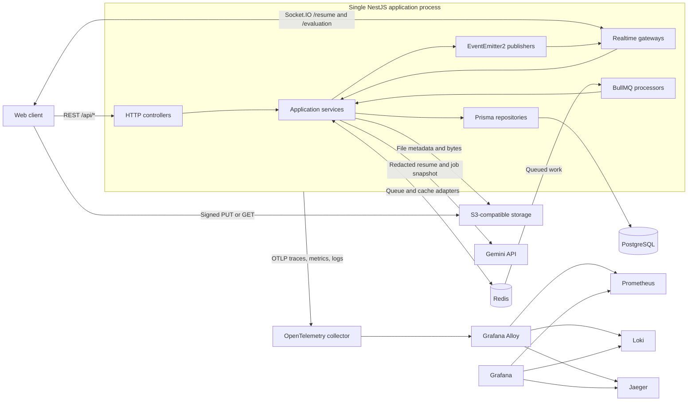

# Architecture specification

[Documentation index](../README.md) · [Database schema](database-schema.md) · [API contracts](api-contracts.md)

## System purpose

Fitwork supports company job postings and applicant submissions. Users upload resumes, apply to jobs, and request an asynchronous AI comparison of a parsed resume against job inputs. Company owners review evaluation evidence and explicitly decide application status. Evaluation does not automatically accept or reject an applicant.

## Runtime topology



The application is a modular monolith. Workers are registered in the same NestJS module graph as the API and gateways; there is no separate worker entry point. Redis queues persist queued work separately from process memory. Realtime publication uses the process-local event emitter, so Redis queue sharing alone does not distribute Socket.IO events across application replicas.

## Technology and entry points

| Concern         | Implementation                                                                 |
| --------------- | ------------------------------------------------------------------------------ |
| Runtime         | Node.js 24 in CI and Docker; TypeScript; NestJS 11 with Express                |
| Persistence     | Prisma 7, PostgreSQL driver adapter and `pg` connection pool                   |
| Background work | BullMQ with `resume-ingestion` and `llm-evaluation` queues                     |
| Cache           | Nest cache manager, Keyv, Redis; application cache abstraction                 |
| Object storage  | AWS SDK v3 against a configured S3-compatible endpoint                         |
| Parsing         | `pdf-parse` 2.4.5 and `mammoth` 1.12.3                                         |
| Evaluation      | Google GenAI Gemini adapter, JSON schemas, AJV, application evidence validator |
| Realtime        | Socket.IO namespaces, JWT handshake authentication, EventEmitter2              |
| Errors          | `neverthrow` results, application error codes, HTTP exception mapping          |
| Telemetry       | OpenTelemetry and structured logging                                           |

[`main.ts`](../../src/main.ts) loads instrumentation before application dependencies, creates the Nest application, installs cookie parsing and DTO validation, configures HTTP CORS, and serves Swagger at `/docs`. [`AppModule`](../../src/app.module.ts) assembles all feature and shared infrastructure modules. The default HTTP port is `3000`.

## Feature modules

| Module                 | Responsibility                                                                                   | Important dependencies                                                |
| ---------------------- | ------------------------------------------------------------------------------------------------ | --------------------------------------------------------------------- |
| `users`                | User persistence, lookup, and creation used by authentication and other services                 | Prisma                                                                |
| `auth`                 | Registration, password verification, JWT issuing, refresh rotation, logout                       | Users, bcrypt, JWT, refresh-token repository                          |
| `job`                  | Job creation/search/update, applications, owner decisions, category/skill/arrangement reads      | Users, resumes, Prisma, reference cache                               |
| `resume`               | Signed file URLs, owned resume metadata, soft deletion, versioned ingestion                      | Storage, Prisma, parsing, BullMQ, notifier                            |
| `applicant-evaluation` | Input preparation, version reuse, redaction, Gemini execution, validated results and owner reads | Job/application data, parsed resume versions, BullMQ, cache, notifier |
| `realtime`             | Authenticated room subscriptions and ingestion/evaluation status delivery                        | JWT, ownership queries, internal event publishers                     |

The users controller has no REST handlers. User profiles exist in the database, but profile CRUD is not currently exposed. Job detail DTO and query code also exist without a corresponding job-detail GET controller route. See the route inventory in [API contracts](api-contracts.md).

## Feature layout and dependency direction

```text
src/modules/<feature>/
  api/               HTTP controllers and API-specific schema declarations
  application/
    dtos/            Use-case request, response, and queue payload types
    interfaces/      Service, query repository, queue, notifier, and provider ports
    services/        Use-case orchestration and result/error handling
  domain/
    entities/        Entities and local business invariants
    value-objects/   Snapshots, evaluation types, status transitions
    repositories/    Persistence contracts for domain operations
    errors/          Domain error types
  infrastructure/    Prisma repositories, mappers, storage/provider/queue adapters
  <feature>.module.ts
```

Controllers depend on injectable abstract service contracts. Services orchestrate domain rules and ports; module providers bind abstract contracts to concrete adapters. Infrastructure maps between Prisma representation and domain/API projections. Query ports provide read DTOs without reconstructing a full domain entity; mutation repositories handle persistence and transactions.

This is a pragmatic hexagonal layout rather than an enforced package boundary. Some application code imports infrastructure validators, and the shared file-storage port resides under infrastructure. Several concrete repositories implement both read and mutation contracts. New features should follow the existing module layout while keeping orchestration in services and database details in adapters.

An example is [`ResumeModule`](../../src/modules/resume/resume.module.ts): it binds resume service, domain repositories, the resume query repository, ingestion service, text extractor, queue, processor, and event publisher. [`ApplicantEvaluationModule`](../../src/modules/applicant-evaluation/applicant-evaluation.module.ts) similarly binds the evaluation repository, processing service, Gemini adapter, queue, redactor, and notifier.

## Request and authorization boundary

1. `@Auth()` installs JWT authentication. Additional `RolesGuard` and `@Roles(...)` metadata are used on selected routes.
2. The JWT exposes `sub`, `email`, and `role`; `@User()` reads this payload. Services resolve `sub` to persisted users where needed.
3. DTO validators reject invalid input. Global validation whitelists DTO fields; resume list additionally enables transformation in its local validation pipe.
4. Services perform resource ownership and business checks. A role alone does not grant access to another user's resume or another company's evaluation.
5. Controllers map application errors to HTTP exceptions. The global exception filter produces the shared error envelope and logs diagnostic context.

JWT validation does not query user activation or token revocation on every request. Login and refresh check activation. Logout revokes refresh credentials; an existing access token remains valid until expiry.

Sources: [`Auth` decorator](../../src/shared/common/swagger/auth-swagger.decorator.ts), [JWT guard](../../src/shared/common/jwt.guard.ts), [roles guard](../../src/shared/common/roles.guard.ts), [error mapper](../../src/shared/common/app-error.mapper.ts), [exception filter](../../src/shared/common/exceptions.filter.ts).

## Persistence, async work, and caching

PostgreSQL stores business state, parsed resume versions, input snapshots, and evaluation results. Storage contains the uploaded binary objects. Redis holds BullMQ state and cache entries; it does not replace database ownership checks.

Resume registration commits resume/content rows before enqueuing ingestion. Evaluation preparation similarly persists versioned inputs before enqueueing. These boundaries have no transactional outbox, so a database commit and Redis enqueue are not atomic. Services record queue submission failures where applicable. Workers validate their stored input and update durable status before publishing notifications.

Queue job IDs use content/evaluation public IDs. Existing queue entries and database version keys reduce duplicate work, but processing and publication are not an exactly-once contract. Both queues use three attempts with exponential backoff. See [workflows](workflows.md) for retry and state behavior.

| Cached read                      | Key/TTL behavior                                              | Authorization                             |
| -------------------------------- | ------------------------------------------------------------- | ----------------------------------------- |
| Skills, categories, arrangements | `reference-data:<resource>:v1`; one hour                      | JWT required by controller                |
| Job owner evaluation detail      | Owner/job/evaluation-specific key; configured application TTL | Job ownership checked before cache access |
| Applicant evaluation detail      | No cache; newest evaluation queried                           | Application filtered by JWT owner and job |
| Resume list/detail               | No cache; current active owned records                        | Owner filter in query repository          |

Reference cache failures are logged and fall through to repository reads. Cache values are DTO projections rather than Prisma entities. Currency normalization currently uses fixed rates: VND `1`, USD `25000` VND per USD; there is no exchange-rate service.

## Observability and lifecycle

HTTP middleware propagates request IDs and logs structured request outcomes. Spans connect HTTP activity, repository/provider work, queues, and realtime publication. Queue payloads carry telemetry context. Metrics use bounded labels rather than resource public IDs. Application errors and provider failures pass through diagnostic helpers that redact sensitive values.

The Compose monitoring stack forwards OTLP through the collector and Alloy to Prometheus, Loki, and Jaeger, with Grafana for inspection. Shutdown handles SIGTERM/SIGINT, closes Nest resources, and shuts down telemetry under a ten-second deadline. See [operations](operations.md) for deployment configuration and pipeline details.

## Implementation boundaries

- PostgreSQL enables `vector` and `pg_trgm`. The latter backs job title search; no vector column or embedding workflow is currently implemented.
- Resume parsing extracts text from PDF/DOCX. OCR for scanned documents is not implemented.
- Resume redaction is local, versioned, and best effort. The Gemini request uses the stored redacted snapshot; redaction is not a guarantee that all personal information is removed.
- Evaluation is advisory. Status changes are a separate owner-authorized action.
- Realtime rooms and event publication are local to each process; the application does not configure a Redis Socket.IO adapter.
- Compose defines database/Redis health checks, but the API does not expose a dedicated health endpoint.
