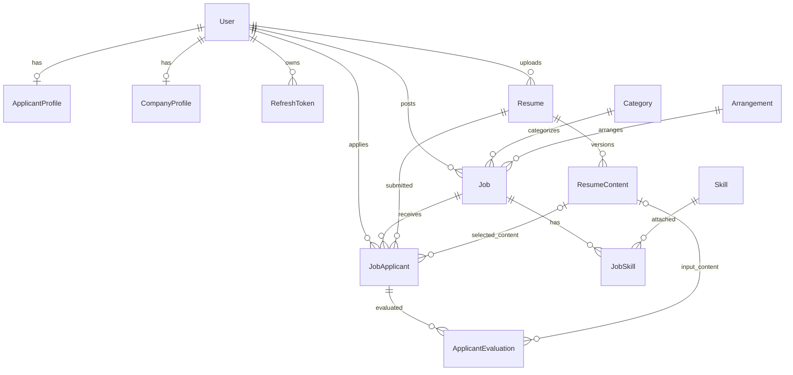

# Database schema specification

[Documentation index](../README.md) · [Architecture](architecture.md) · [Workflows](workflows.md)

## Source of truth and physical representation

The database is PostgreSQL. Prisma definitions are split across [`schema.prisma`](../../prisma/schema.prisma) and [`models/`](../../prisma/models). The following dictionary covers every persisted scalar field in the current 13 models, with SQL types and constraints checked against committed migrations.

- Integer IDs use auto-incrementing primary keys, except JobSkill's composite key. Public IDs are unique UUID strings with a Prisma `uuid()` default; domain entities can also supply UUIDs explicitly. They are physically stored as `TEXT`, not PostgreSQL `UUID` columns.
- Prisma `String` maps to `TEXT` unless annotated otherwise; hashes annotated `@db.VarChar(64)` use `VARCHAR(64)`. `Json` maps to `JSONB`; unconstrained `Decimal` maps to `DECIMAL(65,30)`.
- `DateTime` maps to `TIMESTAMP(3)` without a database timezone. API date serialization is ISO 8601. `@default(now())` has a database timestamp default; `@updatedAt` is maintained by Prisma, not a database trigger.
- Required foreign keys use `ON DELETE RESTRICT`; the two optional resume-content foreign keys use `ON DELETE SET NULL`. All foreign keys use `ON UPDATE CASCADE`. There are no cascading deletions.
- The database enables `vector` and `pg_trgm`. There are currently no vector/embedding columns. Job title trigram search uses `pg_trgm`.

## Entity relationships

Relations show database cardinality. They do not imply role or ownership constraints beyond the foreign keys: matching applicant/resume ownership, company job ownership, and role checks are application responsibilities.

## Enumerations

| Prisma enum             | PostgreSQL enum           | Values                                         |
| ----------------------- | ------------------------- | ---------------------------------------------- |
| `UserType`              | `user_type`               | `COMPANY`, `APPLICANT`                         |
| `FileType`              | `file_type`               | `PDF`, `DOCX`                                  |
| `JobStatus`             | `job_status`              | `OPEN`, `CLOSED`                               |
| `JobApplicantStatus`    | `job_applicant_status`    | `PENDING`, `ACCEPTED`, `REJECTED`, `COMPLETED` |
| `EvaluationStatus`      | `evaluation_status`       | `PENDING`, `PROCESSING`, `COMPLETED`, `FAILED` |
| `ResumeIngestionStatus` | `resume_ingestion_status` | `PENDING`, `PROCESSING`, `COMPLETED`, `FAILED` |
| `UserRole`              | `user_role`               | `ROLE_COMPANY`, `ROLE_APPLICANT`               |
| `Currency`              | `currency`                | `VND`, `USD`                                   |

Database FileType values are uppercase; resume API metadata maps them to `pdf` and `docx`. Shared SystemRole values are not the persisted UserRole enum.

## Model dictionary

“Required” describes NOT NULL. Defaults marked Prisma are supplied or maintained by Prisma; they are not SQL UUID generators or update triggers. Foreign-key destinations are listed separately below.

### User (`user`)

Authentication identity and resource owner. Email is unique; username is not. Registration maps user type to a role in application code. The database has no CHECK enforcing that type and role agree.

Source: [user.prisma](../../prisma/models/user.prisma).

| Prisma field     | SQL column        | SQL type       | Required | Default / field constraint |
| ---------------- | ----------------- | -------------- | -------- | -------------------------- |
| `id`             | `id`              | `SERIAL`       | Yes      | PK; Auto-increment         |
| `publicId`       | `public_id`       | `TEXT`         | Yes      | Unique; UUID (Prisma)      |
| `email`          | `email`           | `TEXT`         | Yes      | Unique                     |
| `username`       | `username`        | `TEXT`         | Yes      | —                          |
| `fullName`       | `full_name`       | `TEXT`         | Yes      | —                          |
| `passwordHashed` | `password_hashed` | `TEXT`         | Yes      | —                          |
| `phoneNumber`    | `phone_number`    | `TEXT`         | No       | —                          |
| `userType`       | `user_type`       | `user_type`    | Yes      | —                          |
| `isActive`       | `is_active`       | `BOOLEAN`      | Yes      | `true`                     |
| `createdAt`      | `created_at`      | `TIMESTAMP(3)` | Yes      | CURRENT_TIMESTAMP          |
| `updatedAt`      | `updated_at`      | `TIMESTAMP(3)` | Yes      | Updated by Prisma          |
| `role`           | `role`            | `user_role`    | Yes      | —                          |

Indexes (including uniqueness indexes; ordinary indexes use B-tree unless stated):

| Index                | Definition           |
| -------------------- | -------------------- |
| `user_public_id_key` | `UNIQUE (public_id)` |
| `user_email_key`     | `UNIQUE (email)`     |

### ApplicantProfile (`applicant_profile`)

Optional one-to-one applicant profile. `skills` is freeform text, not a relation to the Skill catalog. Its unique user FK permits at most one applicant profile per user.

Source: [user.prisma](../../prisma/models/user.prisma).

| Prisma field      | SQL column         | SQL type       | Required | Default / field constraint |
| ----------------- | ------------------ | -------------- | -------- | -------------------------- |
| `id`              | `id`               | `SERIAL`       | Yes      | PK; Auto-increment         |
| `publicId`        | `public_id`        | `TEXT`         | Yes      | Unique; UUID (Prisma)      |
| `description`     | `description`      | `TEXT`         | No       | —                          |
| `avatarUrl`       | `avatar_url`       | `TEXT`         | No       | —                          |
| `portfolioUrl`    | `portfolio_url`    | `TEXT`         | No       | —                          |
| `location`        | `location`         | `TEXT`         | No       | —                          |
| `userId`          | `user_id`          | `INTEGER`      | Yes      | Unique                     |
| `skills`          | `skills`           | `TEXT`         | Yes      | —                          |
| `experienceYears` | `experience_years` | `INTEGER`      | Yes      | —                          |
| `createdAt`       | `created_at`       | `TIMESTAMP(3)` | Yes      | CURRENT_TIMESTAMP          |
| `updatedAt`       | `updated_at`       | `TIMESTAMP(3)` | Yes      | Updated by Prisma          |

Indexes (including uniqueness indexes; ordinary indexes use B-tree unless stated):

| Index                             | Definition           |
| --------------------------------- | -------------------- |
| `applicant_profile_public_id_key` | `UNIQUE (public_id)` |
| `applicant_profile_user_id_key`   | `UNIQUE (user_id)`   |

### CompanyProfile (`company_profile`)

Optional one-to-one company profile. Its unique user FK permits at most one company profile per user. The database does not forbid one user from having both profile kinds. Registration does not create either profile.

Source: [user.prisma](../../prisma/models/user.prisma).

| Prisma field  | SQL column     | SQL type       | Required | Default / field constraint |
| ------------- | -------------- | -------------- | -------- | -------------------------- |
| `id`          | `id`           | `SERIAL`       | Yes      | PK; Auto-increment         |
| `publicId`    | `public_id`    | `TEXT`         | Yes      | Unique; UUID (Prisma)      |
| `companyName` | `company_name` | `TEXT`         | Yes      | —                          |
| `description` | `description`  | `TEXT`         | No       | —                          |
| `avatarUrl`   | `avatar_url`   | `TEXT`         | No       | —                          |
| `location`    | `location`     | `TEXT`         | No       | —                          |
| `website`     | `website`      | `TEXT`         | No       | —                          |
| `industry`    | `industry`     | `TEXT`         | No       | —                          |
| `createdAt`   | `created_at`   | `TIMESTAMP(3)` | Yes      | CURRENT_TIMESTAMP          |
| `updatedAt`   | `updated_at`   | `TIMESTAMP(3)` | Yes      | Updated by Prisma          |
| `userId`      | `user_id`      | `INTEGER`      | Yes      | Unique                     |

Indexes (including uniqueness indexes; ordinary indexes use B-tree unless stated):

| Index                           | Definition           |
| ------------------------------- | -------------------- |
| `company_profile_public_id_key` | `UNIQUE (public_id)` |
| `company_profile_user_id_key`   | `UNIQUE (user_id)`   |

### RefreshToken (`refresh_token`)

One refresh credential/session record. `tokenHash` stores SHA-256 of the opaque token; raw refresh values are never this column. Expiry and revocation are checked by auth services. Rows are retained rather than physically deleted on logout.

Source: [refresh_token.prisma](../../prisma/models/refresh_token.prisma).

| Prisma field | SQL column   | SQL type       | Required | Default / field constraint |
| ------------ | ------------ | -------------- | -------- | -------------------------- |
| `id`         | `id`         | `SERIAL`       | Yes      | PK; Auto-increment         |
| `publicId`   | `public_id`  | `TEXT`         | Yes      | Unique; UUID (Prisma)      |
| `userId`     | `user_id`    | `INTEGER`      | Yes      | —                          |
| `tokenHash`  | `token_hash` | `TEXT`         | Yes      | Unique                     |
| `expiresAt`  | `expires_at` | `TIMESTAMP(3)` | Yes      | —                          |
| `revokedAt`  | `revoked_at` | `TIMESTAMP(3)` | No       | —                          |
| `createdAt`  | `created_at` | `TIMESTAMP(3)` | Yes      | CURRENT_TIMESTAMP          |
| `updatedAt`  | `updated_at` | `TIMESTAMP(3)` | Yes      | Updated by Prisma          |

Indexes (including uniqueness indexes; ordinary indexes use B-tree unless stated):

| Index                          | Definition            |
| ------------------------------ | --------------------- |
| `refresh_token_public_id_key`  | `UNIQUE (public_id)`  |
| `refresh_token_token_hash_key` | `UNIQUE (token_hash)` |
| `refresh_token_user_id_idx`    | `(user_id)`           |

### Job (`job`)

Company-owned posting with original-currency and normalized VND budgets. `version` participates in optimistic concurrency during applicant acceptance. Category and arrangement are required; skills use the join table. Search returns OPEN jobs and does not additionally filter expired deadlines.

Source: [job.prisma](../../prisma/models/job.prisma).

| Prisma field           | SQL column                | SQL type         | Required | Default / field constraint |
| ---------------------- | ------------------------- | ---------------- | -------- | -------------------------- |
| `id`                   | `id`                      | `SERIAL`         | Yes      | PK; Auto-increment         |
| `publicId`             | `public_id`               | `TEXT`           | Yes      | Unique; UUID (Prisma)      |
| `version`              | `version`                 | `INTEGER`        | Yes      | `0`                        |
| `title`                | `title`                   | `TEXT`           | Yes      | —                          |
| `description`          | `description`             | `TEXT`           | Yes      | —                          |
| `requirements`         | `requirements`            | `TEXT`           | Yes      | —                          |
| `location`             | `location`                | `TEXT`           | Yes      | —                          |
| `status`               | `status`                  | `job_status`     | Yes      | —                          |
| `dueAt`                | `due_at`                  | `TIMESTAMP(3)`   | Yes      | —                          |
| `budget`               | `budget`                  | `DECIMAL(65,30)` | Yes      | —                          |
| `currency`             | `currency`                | `currency`       | Yes      | `VND`                      |
| `budgetInBaseCurrency` | `budget_in_base_currency` | `DECIMAL(65,30)` | Yes      | —                          |
| `createdAt`            | `created_at`              | `TIMESTAMP(3)`   | Yes      | CURRENT_TIMESTAMP          |
| `updatedAt`            | `updated_at`              | `TIMESTAMP(3)`   | Yes      | Updated by Prisma          |
| `postedBy`             | `posted_by`               | `INTEGER`        | Yes      | —                          |
| `arrangementId`        | `arrangement_id`          | `INTEGER`        | Yes      | —                          |
| `categoryId`           | `category_id`             | `INTEGER`        | Yes      | —                          |

Indexes (including uniqueness indexes; ordinary indexes use B-tree unless stated):

| Index                              | Definition                               |
| ---------------------------------- | ---------------------------------------- |
| `job_public_id_key`                | `UNIQUE (public_id)`                     |
| `job_posted_by_idx`                | `(posted_by)`                            |
| `job_arrangement_id_idx`           | `(arrangement_id)`                       |
| `job_category_id_idx`              | `(category_id)`                          |
| `job_status_idx`                   | `(status)`                               |
| `job_status_createdAt_dueAt_index` | `(status, created_at DESC, due_at DESC)` |
| `job_title_trgm_idx`               | `USING GIN (title gin_trgm_ops)`         |

### JobApplicant (`job_applicant`)

Application/proposal linking a user, job, and resume. One user may apply once per job. Optional content/snapshot fields are populated during evaluation preparation, rather than application creation, and can be replaced by later preparation. The schema comment describing an immutable apply-time snapshot is therefore stronger than current behavior.

Source: [job.prisma](../../prisma/models/job.prisma).

| Prisma field      | SQL column          | SQL type               | Required | Default / field constraint |
| ----------------- | ------------------- | ---------------------- | -------- | -------------------------- |
| `id`              | `id`                | `SERIAL`               | Yes      | PK; Auto-increment         |
| `publicId`        | `public_id`         | `TEXT`                 | Yes      | Unique; UUID (Prisma)      |
| `jobId`           | `job_id`            | `INTEGER`              | Yes      | —                          |
| `applicantId`     | `applicant_id`      | `INTEGER`              | Yes      | —                          |
| `resumeId`        | `resume_id`         | `INTEGER`              | Yes      | —                          |
| `resumeContentId` | `resume_content_id` | `INTEGER`              | No       | —                          |
| `jobSnapshot`     | `job_snapshot`      | `JSONB`                | No       | —                          |
| `jobContentHash`  | `job_content_hash`  | `VARCHAR(64)`          | No       | —                          |
| `coverLetter`     | `cover_letter`      | `TEXT`                 | Yes      | —                          |
| `proposedRate`    | `proposed_rate`     | `DECIMAL(65,30)`       | Yes      | —                          |
| `estimatedDay`    | `estimated_day`     | `INTEGER`              | Yes      | —                          |
| `status`          | `status`            | `job_applicant_status` | Yes      | `PENDING`                  |
| `appliedAt`       | `applied_at`        | `TIMESTAMP(3)`         | Yes      | CURRENT_TIMESTAMP          |
| `updatedAt`       | `updated_at`        | `TIMESTAMP(3)`         | Yes      | Updated by Prisma          |

Composite constraints:

- `@@unique([jobId, applicantId])`

Indexes (including uniqueness indexes; ordinary indexes use B-tree unless stated):

| Index                                   | Definition                      |
| --------------------------------------- | ------------------------------- |
| `job_applicant_public_id_key`           | `UNIQUE (public_id)`            |
| `job_applicant_job_id_idx`              | `(job_id)`                      |
| `job_applicant_applicant_id_idx`        | `(applicant_id)`                |
| `job_applicant_resume_id_idx`           | `(resume_id)`                   |
| `job_applicant_resume_content_id_idx`   | `(resume_content_id)`           |
| `job_applicant_job_id_applicant_id_key` | `UNIQUE (job_id, applicant_id)` |
| `job_applicant_status_idx`              | `(status)`                      |

### Skill (`skill`)

Structured skill catalog used by jobs and V2 evaluation criteria. Names are not unique. Reference reads expose integer ID and name.

Source: [job.prisma](../../prisma/models/job.prisma).

| Prisma field | SQL column   | SQL type       | Required | Default / field constraint |
| ------------ | ------------ | -------------- | -------- | -------------------------- |
| `id`         | `id`         | `SERIAL`       | Yes      | PK; Auto-increment         |
| `publicId`   | `public_id`  | `TEXT`         | Yes      | Unique; UUID (Prisma)      |
| `name`       | `name`       | `TEXT`         | Yes      | —                          |
| `createdAt`  | `created_at` | `TIMESTAMP(3)` | Yes      | CURRENT_TIMESTAMP          |
| `updatedAt`  | `updated_at` | `TIMESTAMP(3)` | Yes      | Updated by Prisma          |

Indexes (including uniqueness indexes; ordinary indexes use B-tree unless stated):

| Index                 | Definition           |
| --------------------- | -------------------- |
| `skill_public_id_key` | `UNIQUE (public_id)` |

### JobSkill (`job_skill`)

Many-to-many join between jobs and skills. The composite primary key prevents attaching the same skill twice to a job. This model has no separate integer ID or public ID.

Source: [job.prisma](../../prisma/models/job.prisma).

| Prisma field | SQL column   | SQL type       | Required | Default / field constraint |
| ------------ | ------------ | -------------- | -------- | -------------------------- |
| `jobId`      | `job_id`     | `INTEGER`      | Yes      | —                          |
| `skillId`    | `skill_id`   | `INTEGER`      | Yes      | —                          |
| `createdAt`  | `created_at` | `TIMESTAMP(3)` | Yes      | CURRENT_TIMESTAMP          |
| `updatedAt`  | `updated_at` | `TIMESTAMP(3)` | Yes      | Updated by Prisma          |

Composite constraints:

- `@@id([jobId, skillId])`

Indexes (including uniqueness indexes; ordinary indexes use B-tree unless stated):

| Index                    | Definition   |
| ------------------------ | ------------ |
| `job_skill_skill_id_idx` | `(skill_id)` |

### Arrangement (`arrangement`)

Work-arrangement reference catalog. This model has an integer ID and no public ID.

Source: [job.prisma](../../prisma/models/job.prisma).

| Prisma field | SQL column   | SQL type       | Required | Default / field constraint |
| ------------ | ------------ | -------------- | -------- | -------------------------- |
| `id`         | `id`         | `SERIAL`       | Yes      | PK; Auto-increment         |
| `name`       | `name`       | `TEXT`         | Yes      | —                          |
| `createdAt`  | `created_at` | `TIMESTAMP(3)` | Yes      | CURRENT_TIMESTAMP          |
| `updatedAt`  | `updated_at` | `TIMESTAMP(3)` | Yes      | Updated by Prisma          |

### Category (`category`)

Job-category reference catalog. API reference reads expose integer ID and name even though a public ID is also stored.

Source: [job.prisma](../../prisma/models/job.prisma).

| Prisma field | SQL column   | SQL type       | Required | Default / field constraint |
| ------------ | ------------ | -------------- | -------- | -------------------------- |
| `id`         | `id`         | `SERIAL`       | Yes      | PK; Auto-increment         |
| `publicId`   | `public_id`  | `TEXT`         | Yes      | Unique; UUID (Prisma)      |
| `name`       | `name`       | `TEXT`         | Yes      | —                          |
| `createdAt`  | `created_at` | `TIMESTAMP(3)` | Yes      | CURRENT_TIMESTAMP          |
| `updatedAt`  | `updated_at` | `TIMESTAMP(3)` | Yes      | Updated by Prisma          |

Indexes (including uniqueness indexes; ordinary indexes use B-tree unless stated):

| Index                    | Definition           |
| ------------------------ | -------------------- |
| `category_public_id_key` | `UNIQUE (public_id)` |

### Resume (`resume`)

Mutable current metadata for an uploaded resume. `storagePath` is an object key, not a signed URL. `fileName` is the user-provided display name. Soft deletion uses `isActive`; it does not delete the object or content versions.

Source: [resume.prisma](../../prisma/models/resume.prisma).

| Prisma field  | SQL column     | SQL type       | Required | Default / field constraint |
| ------------- | -------------- | -------------- | -------- | -------------------------- |
| `id`          | `id`           | `SERIAL`       | Yes      | PK; Auto-increment         |
| `publicId`    | `public_id`    | `TEXT`         | Yes      | Unique; UUID (Prisma)      |
| `storagePath` | `storage_path` | `TEXT`         | Yes      | —                          |
| `fileSize`    | `file_size`    | `INTEGER`      | Yes      | —                          |
| `fileType`    | `file_type`    | `file_type`    | Yes      | —                          |
| `fileName`    | `file_name`    | `TEXT`         | Yes      | —                          |
| `isActive`    | `is_active`    | `BOOLEAN`      | Yes      | `true`                     |
| `createdAt`   | `created_at`   | `TIMESTAMP(3)` | Yes      | CURRENT_TIMESTAMP          |
| `updatedAt`   | `updated_at`   | `TIMESTAMP(3)` | Yes      | Updated by Prisma          |
| `userId`      | `user_id`      | `INTEGER`      | Yes      | —                          |

Indexes (including uniqueness indexes; ordinary indexes use B-tree unless stated):

| Index                  | Definition           |
| ---------------------- | -------------------- |
| `resume_public_id_key` | `UNIQUE (public_id)` |
| `resume_user_id_idx`   | `(user_id)`          |

### ResumeContent (`resume_content`)

Parsed version of a resume file and parser. File metadata is copied so evaluation history survives a later resume replacement. `contentHash` is SHA-256 of file bytes; `extractedText` is normalized text. Current ingestion does not populate structuredData. Redaction for evaluation is persisted on ApplicantEvaluation rather than this row.

Source: [resume.prisma](../../prisma/models/resume.prisma).

| Prisma field       | SQL column          | SQL type                  | Required | Default / field constraint |
| ------------------ | ------------------- | ------------------------- | -------- | -------------------------- |
| `id`               | `id`                | `SERIAL`                  | Yes      | PK; Auto-increment         |
| `publicId`         | `public_id`         | `TEXT`                    | Yes      | Unique; UUID (Prisma)      |
| `resumeId`         | `resume_id`         | `INTEGER`                 | Yes      | —                          |
| `status`           | `status`            | `resume_ingestion_status` | Yes      | `PENDING`                  |
| `errorMessage`     | `error_message`     | `TEXT`                    | No       | —                          |
| `storagePath`      | `storage_path`      | `TEXT`                    | Yes      | —                          |
| `fileSize`         | `file_size`         | `INTEGER`                 | Yes      | —                          |
| `fileType`         | `file_type`         | `file_type`               | Yes      | —                          |
| `fileName`         | `file_name`         | `TEXT`                    | Yes      | —                          |
| `extractedText`    | `extracted_text`    | `TEXT`                    | No       | —                          |
| `structuredData`   | `structured_data`   | `JSONB`                   | No       | —                          |
| `contentHash`      | `content_hash`      | `VARCHAR(64)`             | No       | —                          |
| `parserVersion`    | `parser_version`    | `TEXT`                    | Yes      | —                          |
| `redactionVersion` | `redaction_version` | `TEXT`                    | No       | —                          |
| `startedAt`        | `started_at`        | `TIMESTAMP(3)`            | No       | —                          |
| `completedAt`      | `completed_at`      | `TIMESTAMP(3)`            | No       | —                          |
| `createdAt`        | `created_at`        | `TIMESTAMP(3)`            | Yes      | CURRENT_TIMESTAMP          |
| `updatedAt`        | `updated_at`        | `TIMESTAMP(3)`            | Yes      | Updated by Prisma          |

Composite constraints:

- `@@unique([resumeId, storagePath, parserVersion], map: "resume_content_version_key")`

Indexes (including uniqueness indexes; ordinary indexes use B-tree unless stated):

| Index                                 | Definition                                         |
| ------------------------------------- | -------------------------------------------------- |
| `resume_content_public_id_key`        | `UNIQUE (public_id)`                               |
| `resume_content_content_hash_idx`     | `(content_hash)`                                   |
| `resume_content_resume_id_status_idx` | `(resume_id, status)`                              |
| `resume_content_version_key`          | `UNIQUE (resume_id, storage_path, parser_version)` |

### ApplicantEvaluation (`applicant_evaluation`)

Versioned evaluation of a job application. Scores/evidence remain nullable until processing succeeds. File-byte and canonical job-snapshot hashes plus parser/model/prompt versions identify reuse. The optional resume content FK supports older records; current preparation persists evaluation-specific input context. Redaction version/hash are stored but excluded from the unique input key.

Source: [job.prisma](../../prisma/models/job.prisma).

| Prisma field         | SQL column             | SQL type            | Required | Default / field constraint |
| -------------------- | ---------------------- | ------------------- | -------- | -------------------------- |
| `id`                 | `id`                   | `SERIAL`            | Yes      | PK; Auto-increment         |
| `publicId`           | `public_id`            | `TEXT`              | Yes      | Unique; UUID (Prisma)      |
| `jobApplicantId`     | `job_applicant_id`     | `INTEGER`           | Yes      | —                          |
| `resumeContentId`    | `resume_content_id`    | `INTEGER`           | No       | —                          |
| `status`             | `status`               | `evaluation_status` | Yes      | `PENDING`                  |
| `overallScore`       | `overall_score`        | `INTEGER`           | No       | —                          |
| `scoreBreakdown`     | `score_breakdown`      | `JSONB`             | No       | —                          |
| `evidence`           | `evidence`             | `JSONB`             | No       | —                          |
| `resumeContentHash`  | `resume_content_hash`  | `VARCHAR(64)`       | Yes      | —                          |
| `jobContentHash`     | `job_content_hash`     | `VARCHAR(64)`       | Yes      | —                          |
| `jobSnapshot`        | `job_snapshot`         | `JSONB`             | No       | —                          |
| `parserVersion`      | `parser_version`       | `TEXT`              | Yes      | —                          |
| `redactedResumeText` | `redacted_resume_text` | `TEXT`              | No       | —                          |
| `redactedResumeHash` | `redacted_resume_hash` | `TEXT`              | No       | —                          |
| `redactionVersion`   | `redaction_version`    | `TEXT`              | No       | —                          |
| `model`              | `model`                | `TEXT`              | Yes      | —                          |
| `promptVersion`      | `prompt_version`       | `TEXT`              | Yes      | —                          |
| `errorMessage`       | `error_message`        | `TEXT`              | No       | —                          |
| `createdAt`          | `created_at`           | `TIMESTAMP(3)`      | Yes      | CURRENT_TIMESTAMP          |
| `evaluatedAt`        | `evaluated_at`         | `TIMESTAMP(3)`      | No       | —                          |
| `updatedAt`          | `updated_at`           | `TIMESTAMP(3)`      | Yes      | Updated by Prisma          |

Composite constraints:

- `@@unique([jobApplicantId, resumeContentHash, jobContentHash, parserVersion, model, promptVersion], map: "applicant_evaluation_input_version_key")`

Indexes (including uniqueness indexes; ordinary indexes use B-tree unless stated):

| Index                                              | Definition                                                                                                |
| -------------------------------------------------- | --------------------------------------------------------------------------------------------------------- |
| `applicant_evaluation_public_id_key`               | `UNIQUE (public_id)`                                                                                      |
| `applicant_evaluation_job_applicant_id_status_idx` | `(job_applicant_id, status)`                                                                              |
| `applicant_evaluation_status_created_at_idx`       | `(status, created_at)`                                                                                    |
| `applicant_evaluation_input_version_key`           | `UNIQUE (job_applicant_id, resume_content_hash, job_content_hash, parser_version, model, prompt_version)` |

## Foreign keys

| From table / column                      | Referenced table / column | On delete  | On update |
| ---------------------------------------- | ------------------------- | ---------- | --------- |
| `job.posted_by`                          | `user.id`                 | `RESTRICT` | `CASCADE` |
| `job.arrangement_id`                     | `arrangement.id`          | `RESTRICT` | `CASCADE` |
| `job.category_id`                        | `category.id`             | `RESTRICT` | `CASCADE` |
| `job_applicant.job_id`                   | `job.id`                  | `RESTRICT` | `CASCADE` |
| `job_applicant.applicant_id`             | `user.id`                 | `RESTRICT` | `CASCADE` |
| `job_applicant.resume_id`                | `resume.id`               | `RESTRICT` | `CASCADE` |
| `job_applicant.resume_content_id`        | `resume_content.id`       | `SET NULL` | `CASCADE` |
| `job_skill.job_id`                       | `job.id`                  | `RESTRICT` | `CASCADE` |
| `job_skill.skill_id`                     | `skill.id`                | `RESTRICT` | `CASCADE` |
| `applicant_evaluation.job_applicant_id`  | `job_applicant.id`        | `RESTRICT` | `CASCADE` |
| `applicant_evaluation.resume_content_id` | `resume_content.id`       | `SET NULL` | `CASCADE` |
| `refresh_token.user_id`                  | `user.id`                 | `RESTRICT` | `CASCADE` |
| `resume.user_id`                         | `user.id`                 | `RESTRICT` | `CASCADE` |
| `resume_content.resume_id`               | `resume.id`               | `RESTRICT` | `CASCADE` |
| `applicant_profile.user_id`              | `user.id`                 | `RESTRICT` | `CASCADE` |
| `company_profile.user_id`                | `user.id`                 | `RESTRICT` | `CASCADE` |

## JSON payloads and version boundaries

| Column                                 | Meaning and application schema                                                                                            |
| -------------------------------------- | ------------------------------------------------------------------------------------------------------------------------- |
| `job_applicant.job_snapshot`           | Job context captured during evaluation preparation; can be overwritten on another preparation                             |
| `applicant_evaluation.job_snapshot`    | Evaluation-specific V1/V2 job input; see [job snapshot types](../../src/modules/job/domain/value-objects/job-snapshot.ts) |
| `applicant_evaluation.score_breakdown` | Version-tagged V1 category scores or V2 criterion contributions                                                           |
| `applicant_evaluation.evidence`        | Version-tagged strengths/gaps/explanation; V2 additionally stores verdicts and exact resume references                    |
| `resume_content.structured_data`       | Nullable extension point; current ingestion stores extracted text rather than structured JSON                             |

Evaluation result types are defined in [evaluation value objects](../../src/modules/applicant-evaluation/domain/value-objects/evaluation.ts) and constrained by [LLM JSON schemas](../../src/modules/applicant-evaluation/infrastructure/llm/applicant-evaluation-response.schema.ts). PostgreSQL JSONB columns do not themselves validate these application schemas.

## Integrity rules: database versus services

| Rule                                                       | Enforcement                                                                                       |
| ---------------------------------------------------------- | ------------------------------------------------------------------------------------------------- |
| Unique email, public IDs, refresh hashes                   | Database unique indexes                                                                           |
| One application per user/job                               | Database composite unique index                                                                   |
| One skill attachment per job/skill                         | Database composite primary key                                                                    |
| One content row per resume/path/parser                     | Database composite unique index                                                                   |
| Evaluation reuse for matching input/model/prompt versions  | Database composite unique index plus preparation logic                                            |
| Valid enum member                                          | PostgreSQL enum and application DTO/domain validation                                             |
| Resume ownership, job owner, applicant role where required | Guards/services/owner-filtered queries; not FK constraints                                        |
| Resume size ≤ 5 MiB; supported MIME/extension              | Storage checks and domain/ingestion validation; no SQL CHECK                                      |
| Nonnegative budget, due date, allowed status transition    | DTO/domain/services; no corresponding SQL CHECK                                                   |
| Score bounds and JSON/evidence correctness                 | Application validators; no SQL CHECK/JSON schema constraint                                       |
| One accepted applicant globally per job                    | No database uniqueness constraint; acceptance rejects other pending applications in a transaction |
| User type agrees with role/profile                         | Registration/application behavior; no database CHECK                                              |

## Index rationale

Job search filters `status`, searches an insensitive title substring, applies category/skill/budget filters, and sorts `createdAt DESC, dueAt DESC`. The compound status/sort index and title GIN trigram index support this workload. FK and application status indexes support joins, counts, and owner decisions. Unique indexes protect version reuse, and evaluation status/time indexes support processing queries.

There is no composite `Resume(userId, isActive, createdAt)` index or dedicated `(resumeId, storagePath, updatedAt)` current-content index. Resume queries use the existing FK and version indexes. An index declaration does not guarantee the planner will select it for every query; use actual query plans when tuning.

## Migration history and client generation

| Migration                                                                                                            | Change                                                                          |
| -------------------------------------------------------------------------------------------------------------------- | ------------------------------------------------------------------------------- |
| [20261005034421_init_db](../../prisma/migrations/20261005034421_init_db/migration.sql)                               | `vector`, eight enums, thirteen tables, original unique/index/FK definitions    |
| [20261010101808_add_job_search_indexes](../../prisma/migrations/20261010101808_add_job_search_indexes/migration.sql) | `pg_trgm`, compound job search index, title GIN index, application-status index |

Prisma reads the schema folder through [`prisma.config.ts`](../../prisma.config.ts). The generated CommonJS client resides under `generated/prisma` and is excluded from Git. Runtime uses the PostgreSQL adapter in [PrismaService](../../src/shared/infrastructure/database/prisma.service.ts). See [operations](operations.md) for migration and generation commands.
