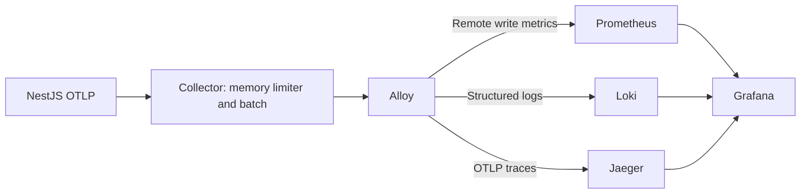

# Operations specification

[Documentation index](../README.md) · [Architecture](architecture.md) · [Database schema](database-schema.md)

## Prerequisites and configuration

Use Node.js 24 and lockfile-based installation. The API needs PostgreSQL, Redis, an S3-compatible bucket, and Gemini credentials for evaluation. The initial migration requires the PostgreSQL `vector` extension; the search migration also requires `pg_trgm`. Compose supplies `pgvector/pgvector:pg15` for the database.

Configuration is loaded through Nest ConfigModule and the instrumentation bootstrap. Prisma CLI separately loads `.env` in `prisma.config.ts`. Do not copy actual secrets into documentation or source control.

| Variable                                                              | Use                                               | Default / requirement                                                                             |
| --------------------------------------------------------------------- | ------------------------------------------------- | ------------------------------------------------------------------------------------------------- |
| `DATABASE_URL`                                                        | Runtime Prisma/pg connection                      | Required by PrismaService                                                                         |
| `DIRECT_URL`                                                          | Alternative tooling connection                    | Prisma config falls back to it only if DATABASE_URL is absent; seed prefers a nonempty DIRECT_URL |
| `REDIS_URL`                                                           | BullMQ and Redis cache connection                 | Required                                                                                          |
| `CACHE_TTL`                                                           | Default application cache TTL, milliseconds       | Required configuration value; example suggests `300000`                                           |
| `JWT_SECRET`                                                          | JWT signing and verification                      | Required                                                                                          |
| `JWT_ACCESS_EXPIRES_IN_SECONDS`                                       | Access token lifetime                             | `900`                                                                                             |
| `JWT_REFRESH_EXPIRES_IN_DAYS`                                         | Refresh lifetime                                  | `30`                                                                                              |
| `LLM_EVALUATION_KEY`                                                  | Gemini API credential                             | Required by Gemini adapter                                                                        |
| `LLM_EVALUATION_MODEL`                                                | Persisted/requested model identifier              | Nonempty value required when preparing evaluation                                                 |
| `S3_API_ENDPOINT`                                                     | S3-compatible endpoint                            | Required                                                                                          |
| `S3_BUCKET_NAME`                                                      | Resume object bucket                              | Required                                                                                          |
| `S3_ACCESS_KEY_ID`                                                    | Storage access key                                | Required                                                                                          |
| `S3_SECRET_ACCESS_KEY`                                                | Storage secret                                    | Required                                                                                          |
| `PORT`                                                                | Application listener                              | `3000`                                                                                            |
| `NODE_ENV`                                                            | Production cookie behavior and runtime convention | Production Docker image sets `production`                                                         |
| `OTEL_SERVICE_NAME`                                                   | Telemetry resource name                           | Compose default `fitwork-nestjs-api`                                                              |
| `OTEL_METRIC_EXPORT_INTERVAL`                                         | Metrics export interval, milliseconds             | `15000`                                                                                           |
| `OTEL_EXPORTER_OTLP_ENDPOINT`                                         | OTLP destination                                  | Compose uses `http://otel-collector:4317`                                                         |
| `OTEL_EXPORTER_OTLP_PROTOCOL`                                         | Export protocol                                   | Compose sets `grpc`                                                                               |
| `OTEL_TRACES_EXPORTER`, `OTEL_METRICS_EXPORTER`, `OTEL_LOGS_EXPORTER` | Signal exporter selection                         | Compose defaults `otlp`                                                                           |
| `OTEL_SDK_DISABLED`                                                   | Disable telemetry SDK                             | Compose default `false`                                                                           |

Compose also reads `POSTGRES_USER`, `POSTGRES_PASSWORD`, `POSTGRES_DB`, `REDIS_PASSWORD`, port overrides, and optional alerting configuration. Storage uses region `auto` and path-style addressing. `S3_API_TOKEN` and `S3_ACCOUNT_ID` exist in the example file but are not credentials read by the current storage adapter.

The checked-in [`.env.example`](../../.env.example) repeats Redis/cache keys and leaves later values blank. Consolidate each key to one intended value when preparing a local `.env`. Its literal `{REDIS_PASSWORD}` Redis URL placeholder is not interpolated by dotenv; supply a complete URL. `prisma.config.ts` uses nullish fallback, so an explicitly empty DATABASE_URL does not fall through to DIRECT_URL.

[`npm run doctor`](../../scripts/doctor-cli.ts) checks Docker, `.env`, and a subset of keys. It still checks `CLOUDFLARE_ACCESS_KEY_ID`/`CLOUDFLARE_SECRET_ACCESS_KEY`, while runtime storage uses the S3-prefixed keys above. It is not a complete runtime configuration validator.

## Local development

```bash
npm ci
cp .env.example .env
```

Fill/consolidate `.env` values before continuing. For host-run NestJS, DATABASE_URL should target the published database port and REDIS_URL the published Redis port. Compose overrides these URLs with service names for its API container. HTTP CORS currently allows `http://localhost:5173` and `http://localhost:3000`; changing frontend origins requires updating the HTTP and gateway configurations.

```bash
docker compose up -d database redis
npx prisma generate
npx prisma migrate deploy
npm run start:dev
```

Swagger is `http://localhost:3000/docs` with the default port. If running without the monitoring stack, configure telemetry for the available collector or set `OTEL_SDK_DISABLED=true` in the local environment.

`npm run seed` runs the configured Prisma seed. It writes data and should target an intended development/test database. Seed/performance tooling uses dedicated database checks and opt-in test URLs; see [performance tooling](../../scripts/perf/README.md) and the [root README](../../README.md) before running large datasets.

## Schema and migration lifecycle

After model changes:

```bash
npx prisma format
npx prisma validate
npx prisma generate
```

For a new schema change, create/review a migration in development and commit both schema and SQL. Apply committed migrations with `npx prisma migrate deploy` against the intended environment. Generated client code under `generated/prisma` is excluded from Git and must be regenerated before build/test after installation or model changes.

Compose and the Docker entry point do **not** apply migrations automatically. Migrations are an explicit deployment step. The CLI config chooses DATABASE_URL before DIRECT_URL; when migrations require a direct/session connection, set the effective CLI DATABASE_URL accordingly. Runtime still requires its own DATABASE_URL.

## Container deployment

[`Dockerfile`](../../Dockerfile) uses three Node 24 Alpine stages: lockfile dependency installation, Prisma generation/application build/production dependency pruning, and a non-root `node` runtime. The actual container command is `node dist/src/main.js`. The package `start:prod` script currently names `dist/main`; verify the compiled entry path before using that script outside Docker.

```bash
docker compose config --quiet
docker compose up -d --build
```

Run migrations as described above before directing application traffic to the new schema. A signed-upload workflow also requires the storage bucket/browser CORS policy to allow direct PUT/GET from the frontend; the API's HTTP CORS policy does not configure object storage.

| Compose service          | Role                                        | Default host port |
| ------------------------ | ------------------------------------------- | ----------------- |
| `fitwork-nestjs-api`     | HTTP, Socket.IO, both worker types          | Loopback `3000`   |
| `database`               | PostgreSQL with vector support              | Loopback `5432`   |
| `redis`                  | BullMQ/cache                                | `6379`            |
| `redis-exporter`         | Redis metrics                               | `9121`            |
| `grafana`                | Dashboards                                  | Loopback `3001`   |
| `prometheus`             | Metrics store and alert rules               | Loopback `9090`   |
| `otel-collector`         | OTLP ingestion                              | Loopback `4317`   |
| `alloy`                  | Telemetry routing                           | Loopback `4201`   |
| `loki`                   | Log store                                   | Loopback `3100`   |
| `jaeger`                 | Trace inspection                            | Loopback `16686`  |
| `alertmanager`           | Optional alert delivery, profile `alerting` | Loopback `9093`   |
| `monitoring-volume-init` | Monitoring volume ownership initialization  | None              |

Redis and redis-exporter mappings are not bound to loopback in the current Compose file. Database/Redis have health checks; the API waits for them and collector startup, but does not itself provide a health route. Named volumes persist database, Redis, and monitoring data. These defaults describe the checked-in development topology, not a complete managed production platform.

## Queue policies and recovery boundaries

| Queue              | Job name               | Job ID                   | Attempts / backoff                          |
| ------------------ | ---------------------- | ------------------------ | ------------------------------------------- |
| `resume-ingestion` | `ingestion.resume`     | Resume content public ID | 3 total; exponential, initial delay 2000 ms |
| `llm-evaluation`   | `evaluation.applicant` | Evaluation public ID     | Same                                        |

Both queues retain completed jobs for up to one day/count 1000 and failed jobs for up to seven days/count 5000 according to BullMQ retention settings. This queue retention is separate from PostgreSQL content/evaluation history; it does not delete database records.

Inspect database status and BullMQ job state together when diagnosing stuck work. Enqueueing is outside the database transaction and has no outbox. Resume transient failures can retain `PROCESSING`; evaluation transient failures reset `PENDING`. A persisted pending row does not by itself prove a queue entry exists. Failed versions can be retried through the existing registration/evaluation use cases as described in [workflows](workflows.md).

Queue IDs and version uniqueness reduce repeat work; they do not provide exactly-once provider calls or notifications. No standalone reconciliation endpoint, durable notification replay, or distributed Socket.IO adapter is implemented. With multiple application replicas, a worker completion event may not reach a socket attached to another process; reconnect/join reads current database state.

## Observability

The bootstrap initializes instrumentation before Nest dependencies for HTTP/Express/Nest, PostgreSQL, Redis, and outgoing HTTP integrations. Structured logs and traces connect request IDs with queue/provider work. HTTP errors include `X-Request-ID`; queue payloads carry trace/request context. Metrics cover queue state, cache outcomes, and Gemini duration/token/failure/validation behavior.



Configuration lives in [`src/monitoring`](../../src/monitoring). Grafana provisions Prometheus/Loki/Jaeger data sources and Fitwork metrics/log dashboards. Alloy routes logs with event-domain/name labels and metrics with service metadata. Metrics avoid per-user/evaluation IDs as labels; sensitive error diagnostics and credential-like content are scrubbed by shared logging helpers.

Optional alerting is enabled with `docker compose --profile alerting up -d`. Compose reads SMTP user/destination configuration and a mounted `.secrets/gmail-app-password` file; the password is not an environment variable in that setup. Consult [Alertmanager configuration](../../src/monitoring/alertmanager/alertmanager.yml) for routing.

SIGTERM/SIGINT initiate application and telemetry shutdown under a ten-second deadline. Resource lifecycle hooks close workers, database/Redis connections, and storage clients where registered. Startup failures are reported through the redacted startup diagnostic path.

## Verification and delivery

For application changes, run the repository checks appropriate to the change:

```bash
npm run lint:check
npm test -- --runInBand
npm run build
```

`npm run lint` modifies files; `lint:check` is read-only. `npm run test:cov` collects coverage with no configured threshold. `npm run test:e2e` uses the separate test configuration. A single colocated test can be run with `npx jest path/to/file.spec.ts`. Seed/performance tests use their own configurations and databases rather than the standard unit suite.

[`backend_ci.yml`](../../.github/workflows/backend_ci.yml) runs lockfile install, Prisma checks/generation, lint, tests, build, and Compose validation with Node 24, with separate integration tooling. [`docker_ci.yml`](../../.github/workflows/docker_ci.yml) controls image build/publishing. Do not interpret a successful build as proof of database migration, external provider connectivity, or realtime behavior across replicas.

For documentation-only changes, check formatting, local source links, schema coverage, and route correspondence. Update the [documentation index](../README.md) when adding a new specification.
