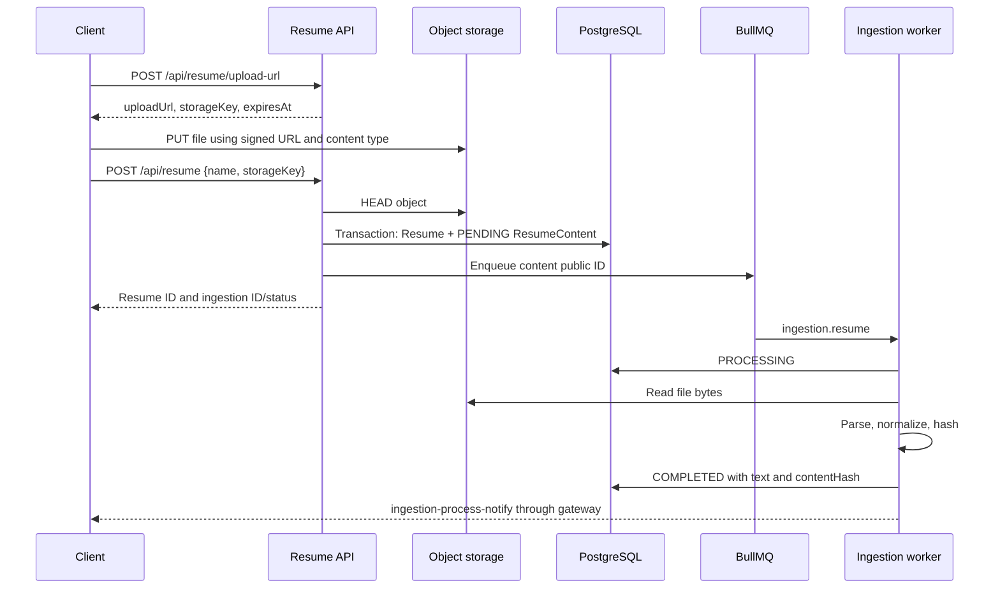
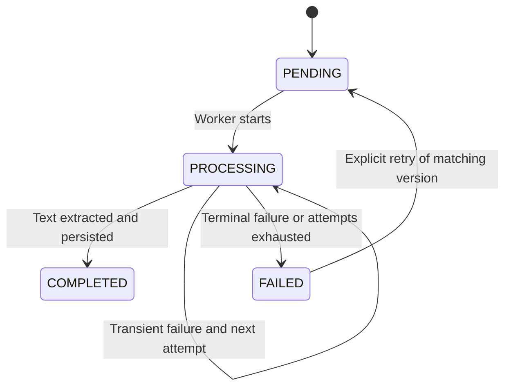
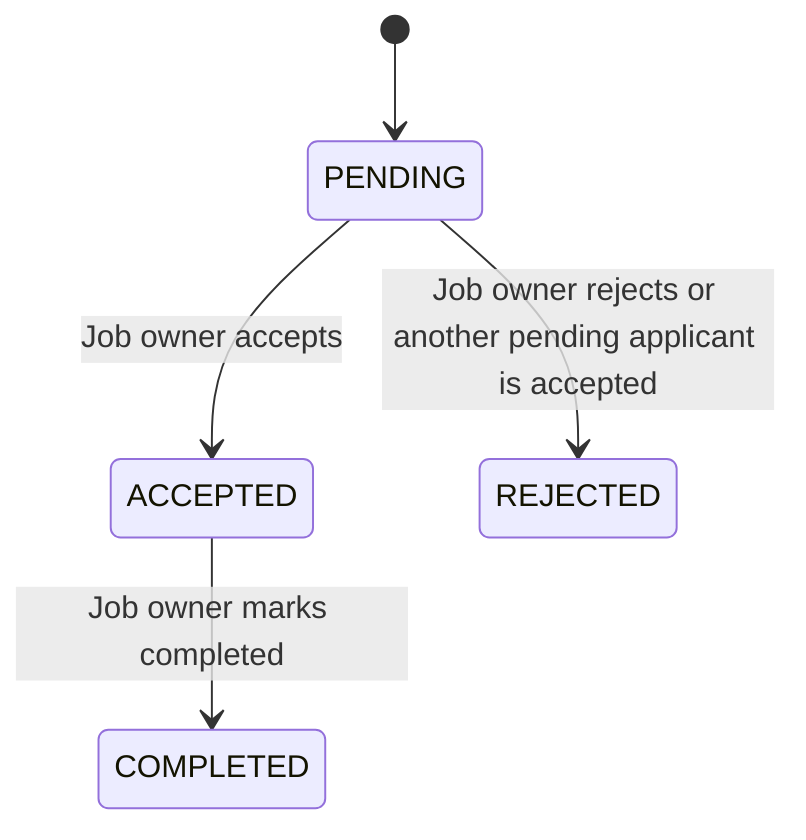
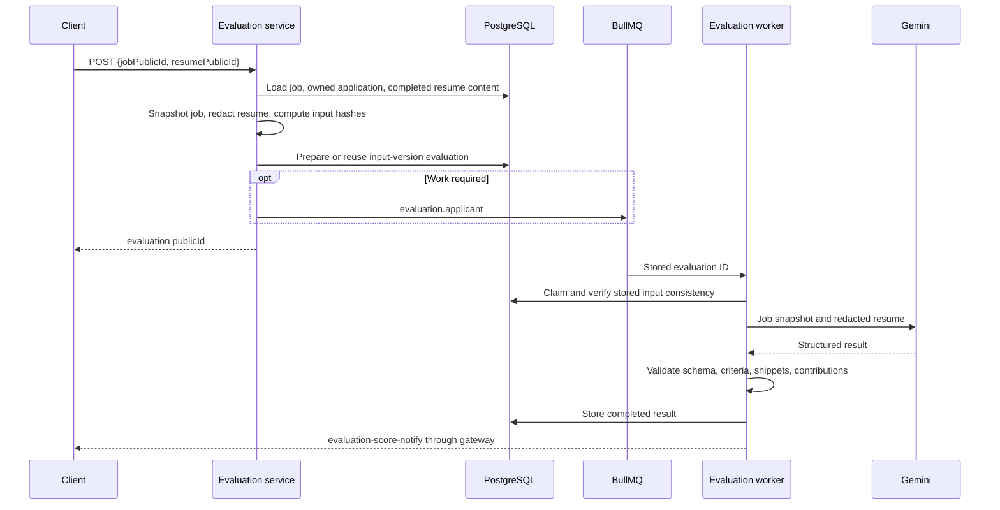

# Business workflow specification

[Documentation index](../README.md) · [API contracts](api-contracts.md) · [Database schema](database-schema.md)

## Registration and sessions

Registration creates a user with the requested `COMPANY` or `APPLICANT` type and its corresponding persisted role. It hashes the password with bcrypt, cost `10`. Profile rows are not created by this repository operation. Email is unique; username is not a database unique key.

Login verifies the password and active user, returns a JWT access token, and sets a refresh cookie. The JWT `sub` is the user's public ID. The opaque refresh token contains 32 random bytes encoded as hex; the database stores its SHA-256 hash rather than its raw value.

Refresh reads the cookie, checks expiry, revocation, and user activation, revokes the old token, and issues fresh credentials. A reused revoked refresh token triggers a revoke-all attempt for the user's refresh sessions. Rotation comprises separate repository operations, not a single atomic transaction. Access defaults to 900 seconds and refresh lifetime to 30 days.

Logout revokes a supplied refresh token and clears the cookie. Because the cookie is scoped to `/api/auth/refresh`, browsers normally do not send it to `/api/auth/logout`; clearing still occurs, but database revocation depends on a token actually reaching logout. Existing JWT access tokens continue until expiry.

Source: [auth service](../../src/modules/auth/application/services/auth.service.ts), [auth controller](../../src/modules/auth/api/auth.controller.ts).

## Resume upload and registration



1. The upload URL endpoint accepts PDF or DOCX MIME types and a positive declared file size. It returns a signed PUT URL valid for 300 seconds and a key under `user/<JWT sub>/<random UUID>/cv.<extension>`.
2. The client uploads directly to object storage. A signed URL alone does not create a database resume.
3. Registration verifies the owner key prefix, object existence, MIME/extension consistency, and actual metadata. Domain registration requires a positive integer size up to `5,242,880` bytes (5 MiB) and a trimmed nonempty name.
4. A transaction creates a mutable `Resume` and a `ResumeContent` snapshot of the current file and parser version. Enqueueing happens after the transaction. An enqueue failure can leave persisted records; the service marks the affected content failed and reports an error.

Updating a resume requires both `name` and `storageKey`, validates the new object, changes current metadata, and creates or reuses a content version. Existing content versions remain available to evaluation history. A failed matching version is reset for retry. Soft deletion sets `isActive = false`; it does not delete storage objects, content history, or evaluations.

The active resume list/detail select ingestion information for the resume's **current storage path**, choosing the most recently updated matching content row. They do not attach a previous file's ingestion status after replacement. Missing matching content yields null ingestion fields. Metadata remains readable during processing or failure.

Sources: [resume service](../../src/modules/resume/application/services/resume.service.ts), [resume repository](../../src/modules/resume/infrastructure/resume.repo.ts), [query repository](../../src/modules/resume/infrastructure/resume.query-repo.ts), [storage adapter](../../src/shared/infrastructure/storage/file-storage.ts).

## Resume ingestion

The `resume-ingestion` queue receives `ingestion.resume` jobs with `resumePublicId`, `resumeContentPublicId`, and optional telemetry context. The queue job ID is the content public ID. An existing active queue entry is reused; retained finished/failed entries can be removed for requeueing.



The worker checks parent/content identity, skips already completed content, marks processing, and downloads the recorded object. It verifies actual byte length against stored metadata and the size limit. PDF/DOCX text is normalized for line endings, NUL characters, and surrounding whitespace; empty extracted text is rejected. `contentHash` is SHA-256 of **the file bytes**, not extracted text.

Parser versions are `pdf-parse@2.4.5/text-v1` and `mammoth@1.12.3/text-v1`. The stored version key is `(resumeId, storagePath, parserVersion)`. Current parsing does not populate a structured resume JSON model and does not perform OCR.

Successful processing stores normalized text/hash and completion time. Transient failures are thrown for queue retry and can leave status `PROCESSING`; terminal failures persist `FAILED` and a bounded error message. Completed content is protected against later failure updates. Database state is authoritative; notification delivery is best effort.

Source: [ingestion service](../../src/modules/resume/application/services/resume-ingestion.service.ts), [processor](../../src/modules/resume/infrastructure/resume-ingestion.processor.ts), [extractor](../../src/modules/resume/infrastructure/resume-text-extractor.ts).

## Application submission and owner decisions

An authenticated user submits a job public ID plus an owned active resume, cover letter, proposed rate, and estimated days. Persistence creates `JobApplicant` in `PENDING`. A database unique key permits at most one application per `(jobId, applicantId)`.

The current submission service checks the referenced user, job, and resume ownership. It does not require completed parsing, does not enforce the applicant role, and does not reject a job because it is closed or past its deadline. Resume ingestion must be complete before requesting evaluation. Duplicate application constraint failures currently become a generic internal error.

Although the schema comment describes an apply-time snapshot, application creation does not populate the optional job snapshot/hash/content-version fields. Evaluation preparation populates these fields later and can overwrite them on subsequent preparation. The evaluation's own input fields preserve the version used for that result.



Only the company job owner may make these transitions. Repeating the current status and transitions from terminal states return a bad request. Repository compare-and-set checks detect a stale application update as a conflict.

Acceptance runs in a transaction: compare/update the expected `Job.version`, accept the selected pending application, and reject the other **pending** applications for that job. Previously accepted applications are not changed. The database does not impose a global unique “one accepted application per job” constraint.

Sources: [application service](../../src/modules/job/application/services/job-applicant.service.ts), [status transitions](../../src/modules/job/domain/value-objects/job-applicant-status-transition.ts), [application repository](../../src/modules/job/infrastructure/job-applicant.repo.ts).

## Evaluation preparation and reuse



Preparation requires the user's existing application for the requested job and resume, plus completed resume content with text and a file hash. It captures the current job context, normalizes/redacts resume text, hashes the redacted text, and persists evaluation inputs.

The unique evaluation input key contains:

```text
jobApplicantId + resumeContentHash + jobContentHash
+ parserVersion + model + promptVersion
```

The resume hash identifies file bytes. The job hash identifies canonical JSON job input. The redacted hash identifies the redacted text, but neither it nor `redactionVersion` is part of the database deduplication key. Redaction is currently local (`resume-redaction-v1`), with regex/contact-header rules; undetected personal information can remain.

Prompt versions are `applicant-match-v1` and `applicant-match-v2`, defined in [evaluation constants](../../src/modules/applicant-evaluation/application/constants/applicant-evaluation.constants.ts). The selected model identifier comes from configuration and is stored with each evaluation.

Matching completed or processing evaluations are returned without a new queue submission. Pending versions are queued. Failed versions can be reset to pending with null results and retried. The POST response always identifies the evaluation; it does not return a computed score.

## Evaluation versions and validation

| Version | Trigger                      | Scoring contract                                                                        |
| ------- | ---------------------------- | --------------------------------------------------------------------------------------- |
| V1      | Job has no structured skills | `skills`, `experience`, `education`, `overallFit`; narrative strengths/gaps/explanation |
| V2      | Job has structured skills    | One criterion per distinct skill; validated evidence and score contributions            |

For V2, each criterion uses `skill:<integer ID>`, text `Experience with <skill name>`, category `SKILL`, `required: false`, and equal weight `100 / number of skills`. Free-form job requirements remain context; they are not converted into additional scored criteria.

Gemini is called with temperature `0`, JSON response MIME type, and a version-specific JSON schema. AJV checks structural validity. The V2 validator additionally requires every known criterion exactly once, the expected criterion text, a contribution between zero and the criterion's weight, and valid verdict/evidence combinations. `MISSING` contributes zero; positive `MATCHED`/`PARTIAL` results require evidence.

Every resume reference uses `section: "resume"`, an exact snippet, and `[startOffset, endOffset)` in the stored redacted text. Offsets follow JavaScript string indexing (UTF-16 code units). If supplied offsets are wrong but the exact quote occurs once, the validator resolves its position. Missing or ambiguous quotes fail validation. The backend rounds the sum of validated contributions to compute V2 `overallScore`.

Before evaluation, the worker verifies snapshot hashes, parser version, and redacted-text hash. Claiming accepts pending or processing rows, so it should not be treated as an exclusive lock across duplicate worker executions. Successful writes require processing state. Transient failures reset evaluation state to pending and clear results; final failures mark failed. Both failures notify status and propagate an error to BullMQ.

Sources: [preparation service](../../src/modules/applicant-evaluation/application/services/applicant-evaluation.service.ts), [processing service](../../src/modules/applicant-evaluation/application/services/applicant-evaluation.processing.service.ts), [V2 validator](../../src/modules/applicant-evaluation/application/services/evaluation-v2-validator.ts), [job snapshots](../../src/modules/job/domain/value-objects/job-snapshot.ts), [Gemini adapter](../../src/modules/applicant-evaluation/infrastructure/llm/providers/applicant-evaluation-gemini.ts).

## Reading results and realtime recovery

Applicant detail receives a **job public ID** and resolves the applicant from JWT `sub`. The query follows job → owned application → evaluations and selects the newest evaluation by `createdAt DESC, id DESC`. It returns conflict while that evaluation's result fields are incomplete; it does not fall back to an older completed version.

The applied-jobs list uses the latest non-null evaluation score and defaults to zero. Consequently, an older score can appear in that list while current evaluation detail returns conflict. Job-owner detail uses an explicit evaluation ID, verifies both job ownership and association, and adds input metadata, redacted resume text, and `decisionSupportOnly: true`.

Socket subscriptions authenticate at connection, check resource ownership before room join, and return the current database state after joining. This helps clients recover from missed events or reconnects. Subsequent notifications carry status and timestamps, not the full evaluation evidence. A client should fetch completed HTTP detail when notified and repeat the room join after reconnecting.
